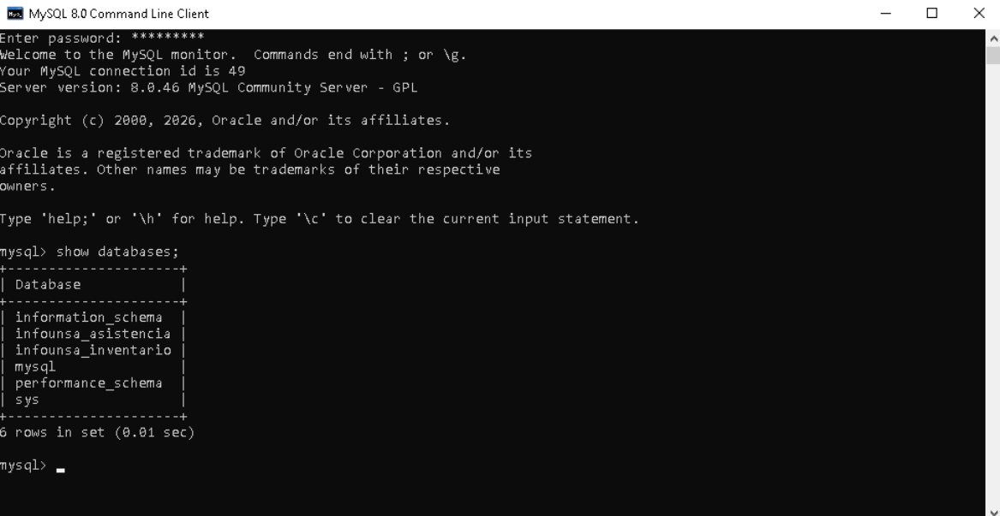
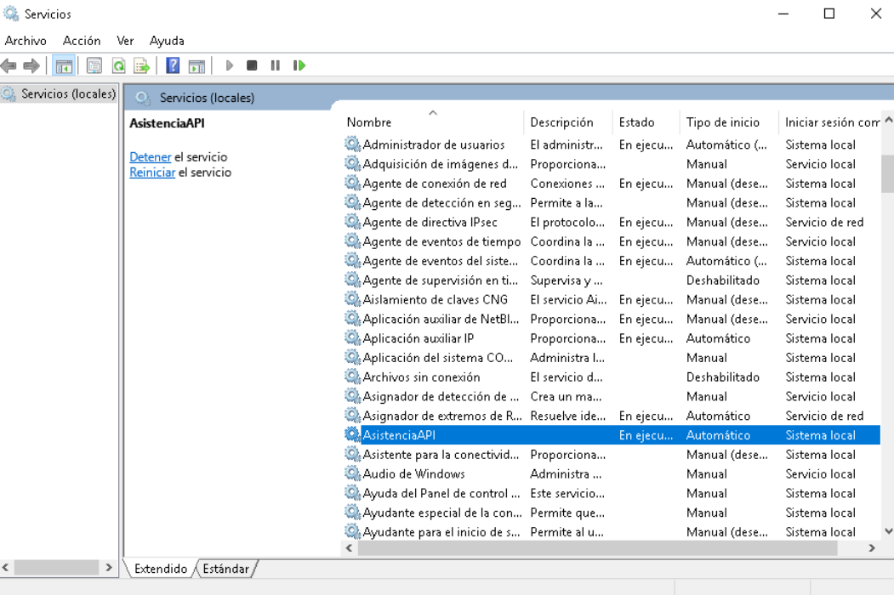

# Manual Técnico de Instalación — API de Asistencia

**Plataforma InfoUNSA** · Windows 10/11 y Windows Server 2019+ (PowerShell como **Administrador**)

Instala la API de Asistencia (NestJS + Prisma + MySQL) en el puerto **43000** y la deja funcionando como servicio de Windows. Si prefieres Docker, consulta la sección *Instalación con Docker* del `README.md` de la raíz.

## Contenido

1. [Requerimientos](#1-requerimientos)
2. [Instalación](#2-instalación): a) Clonar · b) Dependencias · c) Base de datos · d) Archivo `.env` · e) Compilación y ejecución · f) Regla de Firewall · g) Conversión en un servicio
3. [Actualización y respaldos](#3-actualización-y-respaldos)
4. [Problemas frecuentes](#4-problemas-frecuentes)

---

## 1. Requerimientos

| Software | Versión | Descarga |
| :--- | :--- | :--- |
| MySQL Installer (MySQL Server) | 8.0.46 | <https://dev.mysql.com/get/Downloads/MySQLInstaller/mysql-installer-community-8.0.46.0.msi> |
| Node.js LTS | 24.18.0 (22 LTS o superior) | <https://nodejs.org/dist/v24.18.0/node-v24.18.0-x64.msi> |
| pnpm | 9 o superior | `npm install -g pnpm` (después de instalar Node.js) |
| NSSM (*Non-Sucking Service Manager*) | última | <https://nssm.cc/download> (solo para el método 1 de la sección g) |
| Git para Windows | 2.55 | <https://github.com/git-for-windows/git/releases/download/v2.55.0.windows.2/Git-2.55.0.2-64-bit.exe> |

Durante la instalación de Node.js deja marcada la opción **Add to PATH** (necesaria para que el servicio encuentre `node`).

---

## 2. Instalación

### a. Clonar el repositorio

En PowerShell o CMD, en una ruta corta y sin tildes (por ejemplo `C:\Plataforma`):

```powershell
cd C:\Plataforma
git clone https://github.com/mtinta/infounsa-asistencia-inventario.git
cd infounsa-asistencia-inventario
```

(Si se te indicó una rama específica: `git fetch origin` y `git switch --track origin/<rama>`.)

### b. Instalación de dependencias

Desde la **raíz** del repositorio (el proyecto es un monorepo con paquetes compartidos, por eso se usa `pnpm` y no `npm install` dentro de la carpeta de la API):

```powershell
cd C:\Plataforma\infounsa-asistencia-inventario
pnpm install
```

### c. Configuración de la base de datos

1. Abre **MySQL 8.0 Command Line Client** (o tu gestor de base de datos) e ingresa con la contraseña definida al instalar MySQL.
2. Crea la base de datos vacía y compruébala:

   ```sql
   CREATE DATABASE infounsa_asistencia CHARACTER SET utf8mb4 COLLATE utf8mb4_unicode_ci;
   SHOW DATABASES;
   ```

   

3. Crea un usuario dedicado para las APIs (si ya existe `infounsa` por el otro módulo, omite el `CREATE USER`) y otorga permisos:

   ```sql
   CREATE USER 'infounsa'@'localhost' IDENTIFIED BY '<contraseña_segura>';
   GRANT ALL PRIVILEGES ON infounsa_asistencia.* TO 'infounsa'@'localhost';
   FLUSH PRIVILEGES;
   ```

   `infounsa@localhost` es el usuario que recibe los permisos sobre `infounsa_asistencia`. **Anota la contraseña**: se usa en el `.env`.

### d. Creación del archivo `.env`

La API lee el archivo `.env` de su propia carpeta. En PowerShell:

```powershell
cd C:\Plataforma\infounsa-asistencia-inventario\apps\asistencia\api
@"
PORT=43000
NODE_ENV=development
DATABASE_URL=mysql://infounsa:<contraseña_segura>@localhost:3306/infounsa_asistencia
JWT_SECRET=<cadena larga y aleatoria>
ASISTENCIA_ALLOWED_ORIGINS=http://localhost:43000,http://127.0.0.1:43000
"@ | Set-Content .env -Encoding ascii
```

> Usa `-Encoding ascii`: con `utf8`, Windows PowerShell 5.1 agrega una marca BOM que impide leer la primera variable (`PORT`).
> Si la contraseña contiene `@`, `:`, `/` o `#`, escríbela codificada en la URL (por ejemplo `@` → `%40`).
> Agrega a `ASISTENCIA_ALLOWED_ORIGINS` el origen de cualquier aplicación web que consuma la API (separados por comas).

Verifica que se lee correctamente (debe mostrar usuario, contraseña, puerto y base):

```powershell
node -e "require('dotenv').config(); console.log(process.env.DATABASE_URL)"
```

Crea las tablas con Prisma (desde `apps\asistencia\api`, ya con el `.env` creado):

```powershell
npx prisma db push
```

> **No ejecutes los scripts de `apps/asistencia/database/init`** ni `prisma db pull`: están desactualizados respecto al esquema actual (el seed falla con `The column nombre does not exist`) y `db pull` sobrescribiría `prisma/schema.prisma`. Tampoco uses `prisma migrate deploy`: la migración inicial no es compatible con MySQL.

Crea los datos iniciales (roles, sede, terminal y usuarios). El administrador queda con usuario **`admin`** y contraseña **`admin123`** (también se crea `operador_ast` con la misma contraseña); **cámbiala tras el primer inicio de sesión**. Para usar otra contraseña desde el inicio, agrega `SEED_ADMIN_PASSWORD=<contraseña de 8 o más caracteres>` al `.env` antes de ejecutar el seed:

```powershell
npm run db:seed
```

> **Datos de demostración:** por defecto el seed solo crea roles, sede, terminal y los usuarios `admin` y `operador_ast`. Es seguro volver a ejecutarlo: no cambia contraseñas existentes (para forzarlo, `SEED_RESET_PASSWORDS=true`) ni borra marcaciones. Solo con `SEED_DEMO_DATA=true` (entornos de prueba) genera usuarios y marcaciones de ejemplo y **borra todas las asistencias**; no lo uses en producción.

### e. Compilación y ejecución del servidor

En `C:\Plataforma\infounsa-asistencia-inventario\apps\asistencia\api`:

1. Elimina compilaciones anteriores (si las hay):

   ```powershell
   Remove-Item dist -Recurse -Force -ErrorAction SilentlyContinue
   Remove-Item tsconfig.tsbuildinfo -Force -ErrorAction SilentlyContinue
   ```

2. Compila: `npm run build` (equivale a `npx tsc`).
3. Ejecuta el servidor:

   ```powershell
   node .\dist\main.js
   ```

   Debe aparecer `Nest application successfully started` y `Asistencia API escuchando en puerto 43000`.

4. Comprueba en el navegador: `http://localhost:43000/health`. Detén el servidor con `Ctrl + C` antes de continuar con el servicio.

### f. Regla de Firewall

Para que otros equipos de la red (los kioscos o aplicaciones de escritorio) lleguen a la API, crea la regla en PowerShell como administrador (cambia el nombre si lo deseas, y el puerto si usas otro):

```powershell
New-NetFirewallRule `
  -DisplayName "Asistencia API 43000" `
  -Direction Inbound `
  -Protocol TCP `
  -LocalPort 43000 `
  -Action Allow
```

Verifica que existe:

```powershell
Get-NetFirewallRule | Where-Object DisplayName -like "*43000*"
```

> No abras el puerto 3306 (MySQL) hacia la red: solo la API debe conectarse a la base.

### g. Conversión en un servicio

Un servicio permite que la API arranque sola al encender o reiniciar el servidor y se levante si se cae. Hay **dos métodos**: elige uno.

| | Método 1 — NSSM | Método 2 — Script de Windows |
| :--- | :--- | :--- |
| Qué crea | Servicio `AsistenciaAPI` (visible en `services.msc`) | Tarea programada `InfoUNSA-Servidores` (corre como `SYSTEM`) |
| Software extra | NSSM | Ninguno |
| Si la API se cae | Se reinicia sola a los 5 s | Se reintenta hasta 3 veces |
| Gestiona | Solo esta API | Asistencia e Inventario juntas |

#### Método 1 — NSSM

1. Abre PowerShell como administrador en la carpeta de NSSM (por ejemplo `C:\nssm\win64`) y ejecuta:

   ```powershell
   .\nssm.exe install AsistenciaAPI
   ```

2. Se abre una ventana. En la pestaña **Application** configura:

   | Campo | Valor |
   | :--- | :--- |
   | Path | `C:\Program Files\nodejs\node.exe` |
   | Startup directory | `C:\Plataforma\infounsa-asistencia-inventario\apps\asistencia\api` |
   | Arguments | `dist\main.js` |
   | Service name | `AsistenciaAPI` |

3. Pulsa **Install service**.

**Alternativa por línea de comandos** (equivalente, sin ventana), desde la carpeta de `nssm.exe`:

```powershell
$svc = "AsistenciaAPI"
$dir = "C:\Plataforma\infounsa-asistencia-inventario\apps\asistencia\api"
New-Item -ItemType Directory -Force C:\Plataforma\infounsa-asistencia-inventario\.run\logs | Out-Null
.\nssm.exe install $svc "C:\Program Files\nodejs\node.exe" "dist\main.js"
.\nssm.exe set $svc AppDirectory $dir
.\nssm.exe set $svc Start SERVICE_AUTO_START
.\nssm.exe set $svc AppExit Default Restart
.\nssm.exe set $svc AppRestartDelay 5000
.\nssm.exe set $svc AppStdout "C:\Plataforma\infounsa-asistencia-inventario\.run\logs\asistencia-api.log"
.\nssm.exe set $svc AppStderr "C:\Plataforma\infounsa-asistencia-inventario\.run\logs\asistencia-api.err.log"
.\nssm.exe set $svc DependOnService MySQL80
.\nssm.exe start $svc
```

**Automático para las dos APIs a la vez**, con el script del repositorio:

```powershell
cd C:\Plataforma\infounsa-asistencia-inventario
powershell -ExecutionPolicy Bypass -File scripts\instalar-servicios-nssm.ps1 -NssmPath C:\nssm\win64\nssm.exe -MySqlService MySQL80
```

**Operación del servicio:**

```powershell
Start-Service AsistenciaAPI              # o: sc start AsistenciaAPI
Get-Service AsistenciaAPI                # debe indicar Status: Running
Set-Service AsistenciaAPI -StartupType Automatic    # inicio automático (también en services.msc)
Stop-Service AsistenciaAPI
Restart-Service AsistenciaAPI
```



Con el inicio automático, al reiniciar Windows Server la API arrancará sola.

**Quitar el servicio:** `.\nssm.exe remove AsistenciaAPI confirm`.

#### Método 2 — Script de Windows (tarea programada)

No requiere instalar nada. Desde la raíz del repositorio, en PowerShell como administrador:

```powershell
cd C:\Plataforma\infounsa-asistencia-inventario

# Si las bases de datos son un MySQL instalado en Windows (este manual):
powershell -ExecutionPolicy Bypass -File scripts\instalar-autoarranque.ps1 -SinDocker

# Si las bases de datos corren en Docker, omite -SinDocker.
```

El script registra la tarea `InfoUNSA-Servidores`, que al arrancar Windows (con 1 minuto de espera para que MySQL esté listo) inicia **ambas APIs** en segundo plano. Para probarla sin reiniciar:

```powershell
Start-ScheduledTask -TaskName InfoUNSA-Servidores
Get-ScheduledTask   -TaskName InfoUNSA-Servidores
Invoke-WebRequest http://localhost:43000/health
```

Detener: `powershell -File scripts\detener-servidores.ps1`. Quitar la tarea: `powershell -ExecutionPolicy Bypass -File scripts\instalar-autoarranque.ps1 -Quitar`.

> No uses los dos métodos a la vez (los dos intentarían abrir el mismo puerto). Detalles adicionales en el [Anexo de servicios de Windows](Anexo-servicios-windows.md).

**Comprobación final (ambos métodos):** reinicia el servidor y abre `http://localhost:43000/health` sin iniciar sesión en Windows.

---

## 3. Actualización y respaldos

**Actualizar la API** (con el servicio instalado):

```powershell
cd C:\Plataforma\infounsa-asistencia-inventario
git pull
pnpm install
npm run build --prefix apps\asistencia\api
Restart-Service AsistenciaAPI        # Método 2: Stop-ScheduledTask InfoUNSA-Servidores; Start-ScheduledTask InfoUNSA-Servidores
```

**Respaldo de la base de datos** (programar a diario con el Programador de tareas):

```powershell
mysqldump -u infounsa -p --single-transaction infounsa_asistencia > respaldo-asistencia-AAAAMMDD.sql
```

Restaurar (PowerShell): `Get-Content respaldo-asistencia-AAAAMMDD.sql | mysql -u infounsa -p infounsa_asistencia`.

---

## 4. Problemas frecuentes

| Síntoma | Causa y solución |
| :--- | :--- |
| `P1001: Can't reach database server` | MySQL apagado o `DATABASE_URL` incorrecta (host, puerto, usuario, contraseña). |
| La API se cierra al arrancar | Revisa `.run\logs\*.err.log`. Suele faltar `JWT_SECRET` o `DATABASE_URL` en el `.env` de `apps\asistencia\api`. |
| `EADDRINUSE` | El puerto 43000 está ocupado: `Get-NetTCPConnection -LocalPort 43000` y `Stop-Process -Id <PID>`. |
| El servicio se detiene al instante | Falta el `.env`, no se compiló (`dist\main.js`) o `node` no está en el `PATH` del sistema. |
| `Cannot find module ... generated/prisma` | Ejecuta `pnpm install` en la raíz (genera el cliente de Prisma). |
| Las apps no se conectan desde otros equipos | Falta la regla de firewall (sección f) o el origen no está en `ASISTENCIA_ALLOWED_ORIGINS`. |
| `The column nombre does not exist` | La base se creó con scripts SQL antiguos. Usa una base vacía y `npx prisma db push`. |
