# Manual de Usuario — Sistema de Asistencia

**Plataforma InfoUNSA**

## 1. INTRODUCCIÓN Y REQUISITOS

### 1.1. Sobre la Plataforma INFOUNSA - Módulo de Asistencia

La aplicación de escritorio **INFOUNSA Asistencia** es el componente visual (Frontend) diseñado para la gestión y captura del registro de ingresos, salidas y permanencia del personal de la institución. Este sistema trabaja de manera híbrida: procesa y valida los datos de forma local a través de una base de datos segura y se comunica en tiempo real con los servidores centrales de **INFOUNSA** mediante servicios (API) dedicados para consolidar la información.

### 1.2. Requisitos Mínimos del Sistema Operativo

Para garantizar un rendimiento fluido del escáner y la correcta persistencia de las marcaciones, la estación de trabajo debe cumplir con los siguientes requerimientos:

- Sistema Operativo: Windows 10 o Windows 11 (Arquitectura de 64 bits).
- Memoria RAM: Mínimo 4 GB (Se recomiendan 8 GB para un procesamiento de video más ágil).
- Hardware Opcional: Cámara web integrada o externa (USB) con resolución mínima de 720p (HD) para el correcto funcionamiento del lector visual.
- Conectividad: Red local (LAN) o Wifi con visibilidad hacia el servidor de la base de datos central.

### 1.3. Proceso de Instalación del Ejecutable (.exe)

El despliegue de la aplicación se realiza mediante un instalador único automatizado. Siga estos pasos para añadir el programa al equipo:

- Localice el archivo instalador generado por el equipo técnico: InfoUNSA-Asistencia-Setup-1.3.10-x64.exe.
- Haga doble clic sobre el archivo para iniciar el asistente de instalación.
- El instalador preparará el entorno de Electron de forma automática. El asistente le permitirá elegir la carpeta de instalación (puede aceptar la que propone por defecto) y creará los accesos directos.
- Una vez finalizada la copia de archivos, el sistema creará un acceso directo en el Escritorio de Windows y en el Menú de Inicio con el nombre InfoUNSA-Asistencia.
- **Actualización o reinstalación:** ejecute el nuevo instalador sobre el existente. Sus datos locales (marcaciones o movimientos pendientes de sincronizar, sesión y configuración) se conservan y **no debe eliminar nada**. Solo si el equipo técnico le indica una instalación completamente limpia (se perderán los registros locales no sincronizados), elimine la carpeta infounsa-asistencia-desktop, ubicada en:

`C:\Users\<nombre_de_usuario>\AppData\Roaming`

También puede acceder a esta ubicación presionando Windows + R, escribiendo %APPDATA% y presionando Enter.

### 1.4. Primer Inicio de la Aplicación en Windows

Al abrir la aplicación por primera vez, el sistema cargará los módulos base en la memoria de la computadora y ejecutará una prueba de comunicación hacia el servidor local (mapeado al puerto base del sistema). Si la infraestructura central está activa, la interfaz gráfica mostrará inmediatamente el formulario de inicio de sesión seguro.

## 2. CONTROL DE ACCESOS Y SEGURIDAD

### 2.1. Interfaz de Autenticación (Login)

Al iniciar la aplicación, se desplegará la ventana de acceso seguro. La interfaz es minimalista y está diseñada para que el operador valide su identidad antes de manipular los datos de asistencia.

- Para ingresar al sistema, realice los siguientes pasos:
- Campo Usuario: Escriba el nombre de usuario asignado por el área de sistemas (por ejemplo, admin o su identificador de operador).
- Campo Contraseña: Introduzca la clave de seguridad correspondiente. Por motivos de protección, los caracteres se ocultarán automáticamente.
- Botón Entrar: Haga clic en el botón "Entrar" (o presione la tecla Enter en su teclado) para validar las credenciales e ingresar al panel principal.

### 2.2. Estado del Servidor (Indicador de Conectividad)

En esta misma pantalla de inicio de sesión, el sistema cuenta con un monitor inteligente de conectividad en tiempo real. Antes de intentar escribir sus datos, el operador siempre debe revisar el estado del indicador visual:

- Indicador Verde (ONLINE): Significa que la aplicación de escritorio se está comunicando con éxito con el servidor central de la plataforma . Puede iniciar sesión normalmente.
- Indicador Rojo (OFFLINE): Significa que la aplicación no puede detectar el servidor central. El botón de ingresar podría deshabilitarse o arrojar un error inmediato.

### 2.3. Procedimiento ante Fallas de Inicio de Sesión o Conexión

Si al intentar ingresar el sistema experimenta problemas, siga este protocolo de soporte básico:

1. Si el indicador está en ROJO:
    - Verifique que la computadora tenga acceso a la red local.
    - Asegúrese de que el servidor central esté encendido y corriendo en la dirección configurada.
    - Configure correctamente la dirección del servidor haciendo uso del menú desplegable Configuración del Servidor haciendo clic en en la rueda de configuración en la parte superior derecha.

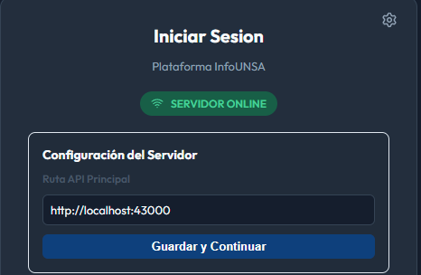

1. Si el indicador está en VERDE pero da "Error de Credenciales":
    - Revise que la tecla de mayúsculas (Bloq Mayús) no esté activa por error.
    - Recuerde que el usuario inicial de administración del sistema (admin) usa la contraseña definida por el equipo técnico en la instalación (en una instalación nueva, por defecto, `admin123`; se recomienda cambiarla tras el primer ingreso). Si la ha olvidado, solicite un restablecimiento al equipo técnico.

## 3. ENTORNO DE TRABAJO E INTERFAZ GRÁFICA

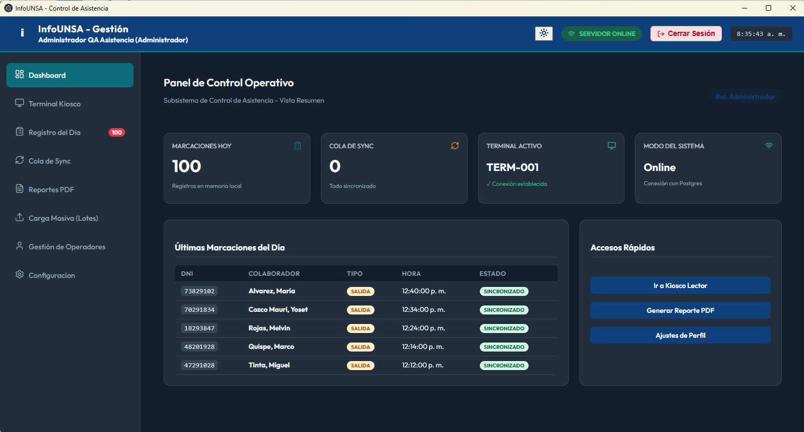

Figura 1: (Imagen completa de Dashboard del panel de control general)

### 3.1. Panel de Control General (Dashboard)

Una vez que el usuario inicia sesión con éxito, la aplicación despliega el Panel de Control Operativo. Esta interfaz ha sido optimizada para ofrecer una vista de resumen inmediata sobre el estado técnico y operativo del punto de control de asistencia. En la parte superior derecha, el operador siempre podrá visualizar su nombre, rol asignado (Administrador), la confirmación del estado del servidor y la hora exacta del sistema (figura 1).

### 3.2. Barra de Navegación Lateral (Módulos)

En el lateral izquierdo de la pantalla se ubica el menú de navegación principal. El operador puede conmutar entre los distintos módulos del sistema con un solo clic:

- Dashboard: Retorna de inmediato a esta vista de resumen general.
- Terminal Kiosco: Abre la interfaz de pantalla completa dedicada a la lectura de fotochecks con cámara web.
- Registro del Día: Permite auditar la lista de personas que ya marcaron durante la jornada.
- Cola de Sync: Muestra los registros almacenados temporalmente en la memoria local pendientes de subida al servidor central.
- Reportes PDF: Sección dedicada a la exportación de documentos oficiales de asistencia.
- Carga Masiva: Permite al usuario la subida de archivos xlsx con información de usuarios para registrarlos en el sistema, asimismo provee un botón de descarga para esta plantilla.
- Gestión de Operadores: Módulo administrativo para dar de alta o modificar cuentas de usuarios de la aplicación.
- Configuración: Permite cambiar parámetros críticos del hardware y las rutas de enlace del sistema.

### 3.3. Interpretación de Tarjetas de Control Operativo

El centro del Dashboard está compuesto por cuatro indicadores clave en tiempo real:

- Marcaciones Hoy: Muestra un contador gigante con el número de registros guardados de forma local durante el turno actual.
- Cola de Sync: Indica la cantidad de marcaciones que están en cola para subirse a la red. Si el sistema está funcionando correctamente, mostrará 0 junto a la leyenda Todo sincronizado.
- Terminal Activo: Muestra el identificador único de la computadora (por ejemplo, TERM-001) y el estado del enlace local (Conexión establecida).
- Modo del Sistema: Confirma el tipo de arquitectura activa. Al estar en Online, ratifica que los datos están respaldados directamente e impactando en la base de datos principal de la plataforma.

### 3.4. Secciones Inferiores de Control Rápido

En la parte baja del panel, se encuentran dos bloques de interacción rápida para el flujo cotidiano del operador:

- Últimas Marcaciones del Día: Es un historial dinámico que muestra los nombres y horas de los últimos empleados en registrarse. Cuando el turno está iniciando o no ha habido actividad, la tabla se mantendrá limpia desplegando el mensaje informativo: "No hay marcas registradas en el turno actual".
- Accesos Rápidos: Bloque de botones directos para agilizar las tareas más repetitivas del operador sin tener que buscarlas en el menú lateral. Contiene tres funciones:
    - Ir a kiosco lector: Salta directo a encender la cámara para recibir al personal.
    - Generar reporte pdf: Abre la ventana de descargas directamente.
    - Ajustes de perfil: Permite al operador gestionar los datos de su propia cuenta de acceso de forma veloz.

## 4. MÓDULO OPERATIVO CENTRAL: QUIOSCO DE MARCADO

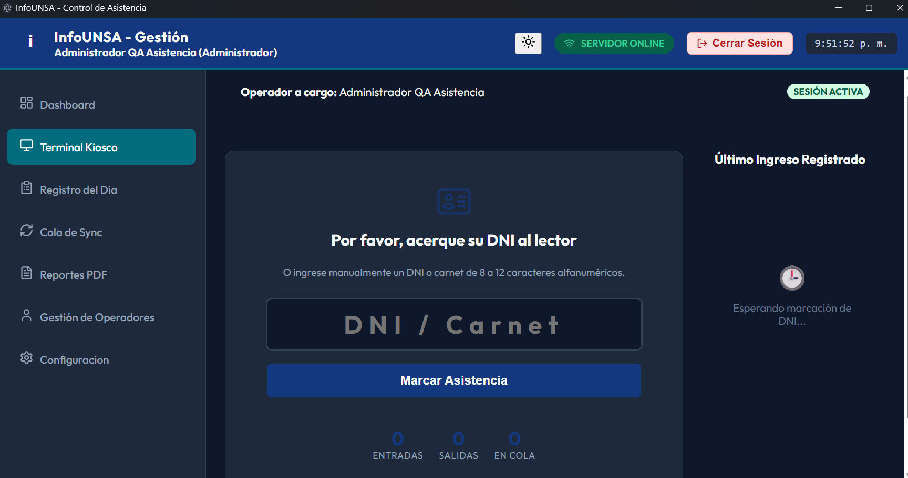

Figura 2: Imagen completa de la interfaz de terminal kiosco

Este módulo es la interfaz principal de cara al público, diseñada para permanecer abierta continuamente en las estaciones de control periféricas con el fin de registrar las jornadas laborales del personal.

### 4.1. Preparación de la Terminal y Estado Operativo

Antes de iniciar la recepción de usuarios, el operador a cargo debe validar tres elementos clave integrados en la cabecera del panel:

- Operador a cargo: Muestra la identidad del trabajador que supervisa la estación (por ejemplo, Administrador QA Asistencia).
- Estado de Sesión: Una etiqueta en la esquina superior derecha indicará SESIÓN ACTIVA en color verde, lo que garantiza que la terminal está lista para procesar transacciones.
- Contadores de Turno: En la parte inferior central se despliega una barra estadística que contabiliza en tiempo real las Entradas, Salidas y registros pendientes En Cola correspondientes de forma exclusiva a la sesión actual de esa máquina.

### 4.2. Procedimiento Correcto para el Registro de Personal (Marcación)

El sistema ofrece flexibilidad para registrar la asistencia mediante hardware de escaneo periférico o mediante captura manual de contingencia.

1. Método A: Usuario registrado en la base de datos

Si el usuario ya se encuentra registrado en el sistema, puede realizar la marcación de asistencia de cualquiera de las siguientes formas:

    - **Ingreso manual:** Escriba el número de DNI en el campo **DNI / Carnet**.
    - **Escaneo de código de barras:** Acerque el DNI al lector de código de barras o colóquelo frente a la cámara configurada para el escaneo. El sistema leerá automáticamente el código y procesará la marcación de asistencia
1. Método B: Usuario no registrado en la base de datos

Si el usuario no se encuentra registrado en el sistema:

- Escriba el número de DNI en el campo **DNI / Carnet**.
- Presione el botón **Marcar Asistencia**.
- El sistema mostrará el formulario de registro (véase la **Figura 3**).
- Complete los datos solicitados, incluyendo la información personal y el motivo de la visita.
- Finalmente, haga clic en **Guardar marcación** para registrar la asistencia y almacenar la información del nuevo usuario en el sistema.

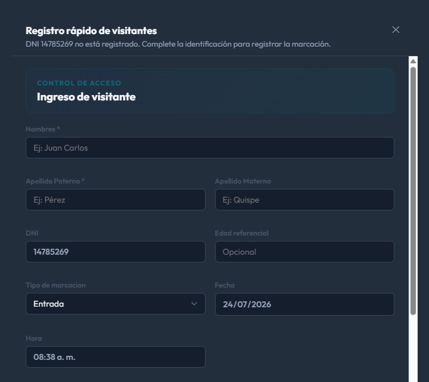

Figura 3: Formulario de marcación

### 4.3. Panel Dinámico: Último Ingreso Registrado

El bloque ubicado en la sección inferior de la pantalla actúa como un espejo de auditoría inmediata.

- Estado de Espera: Mientras el sistema permanezca inactivo esperando una interacción, mostrará un icono de reloj junto con la leyenda informativa: "Esperando marcación de DNI...".
- Registro Exitoso (Check Verde): Al procesar un DNI válido, la pantalla parpadeará temporalmente en color verde, emitirá un pitido de confirmación y proyectará en este bloque la fotografía del empleado, sus nombres completos, la hora exacta del evento y el tipo de registro (Entrada/Salida).

## 5. MONITOREO EN TIEMPO REAL Y REGISTROS DEL DÍA

### 5.1. Módulo Marcaciones del Día

Este submódulo permite al operador de la terminal validar de forma rápida la actividad de la sesión actual sin necesidad de generar un documento final, vea la figura 4.

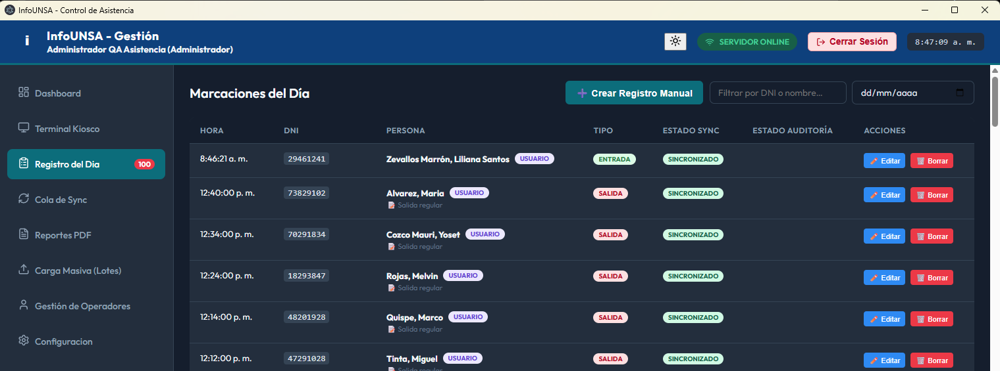

Figura 4: Imagen completa de marcaciones y registros del dia

- Barra de Búsqueda Dinámica: En la esquina superior derecha, cuenta con la caja de texto "Filtrar por DNI o nombre" para buscar de forma inmediata a un trabajador específico en la cuadrícula.
- Filtro por Calendario: Permite seleccionar un día específico mediante el selector de fecha (dd/mm/aaaa).
- Estado Vacío: Si la terminal acaba de ser abierta o no se han procesado registros en las últimas horas, la pantalla mostrará de forma segura el mensaje informático: "No se registran marcas en la sesión actual."

## 6. SINCRONIZACIÓN Y GESTIÓN OFFLINE

### 6.1. Interfaz Outbox - Cola Offline

La aplicación de escritorio cuenta con un sistema de persistencia local en caso de caídas de red, gestionado desde el módulo Cola de Sync, vea la Figura 5.

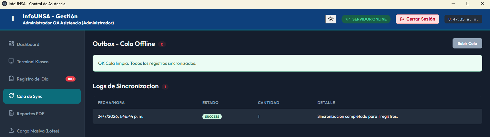

Figura 5: Imagen completa del submodulo cola de sync

- Contador de Pendientes: Al lado del título "Outbox - Cola Offline", un círculo numérico indica la cantidad de marcas retenidas en la memoria local que no han podido viajar al servidor central. Si está en 0 y la barra verde indica "OK Cola limpia. Todos los registros sincronizados.", el sistema está al día.
- Botón Subir Cola: Ubicado en la esquina superior derecha. En caso de que el sistema recupere la conexión tras un periodo offline, el operador puede presionar "Subir Cola" para forzar manualmente el vaciado del búfer local hacia el servidor.
- Logs de Sincronización: En la parte inferior se muestra el historial de intentos de comunicación. Si no ha habido problemas previos de red, se visualizará el mensaje de control: "No hay registros de intentos de sincronización todavía."

## 7. GESTIÓN DE REPORTES Y DESCARGAS

### 7.1. Configuración del Rango de Fechas

El módulo Generador de Reportes PDF permite consolidar la asistencia del personal estableciendo un marco de tiempo específico mediante dos selectores obligatorios:

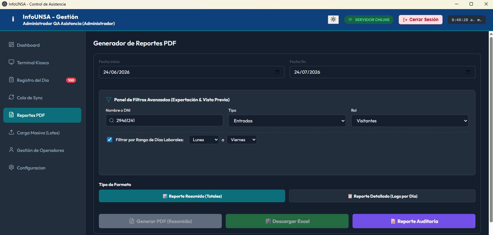

Figura 6: Imagen de filtros de fecha y tipo de formato en el generador de reportes

### 7.2. Selección del Tipo de Formato

Debajo de las fechas, la sección "Tipo de Formato" ofrece opciones exclusivas para estructurar la información según las necesidades del operador. El formato seleccionado se iluminará en color verde azulado:

- Reporte Resumido (Totales): Consolida las métricas generales, ideal para visualizar rápidamente las horas totales acumuladas, tardanzas o faltas globales en el rango de fechas.
- Reporte Detallado (Logs por Día): Desglosa línea por línea cada marca individual con su respectiva fecha y hora exacta, ideal para auditorías minuciosas.

Nota de usabilidad: El botón principal de descarga inferior cambiará su texto de forma automática según la opción elegida, mostrando "Generar PDF (Resumido)" o "Generar PDF (Detallado)".

El usuario también puede descargar la información en formato excel para su manipulación, haciendo click en el botón Verde.

De la misma manera se puede descargar un reporte de auditoría con el botón Morado.

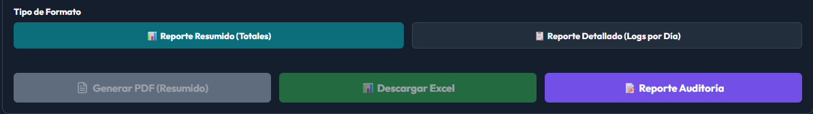

Figura 7: imagen de tipo de formato

### 7.3. Validación y Control de Errores (Vista Previa)

Para evitar la exportación de documentos en blanco o corruptos, el sistema integra un motor de validación previa en la parte inferior del módulo.

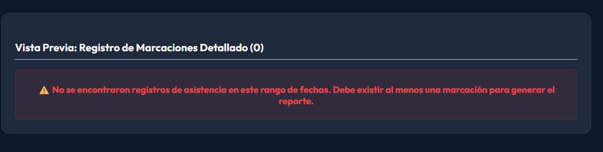

Figura 8: Imagen de vista previa

Si los parámetros de fecha ingresados no contienen actividad en la base de datos, la sección "Vista Previa: Resumen de Totales (0)" bloqueará la generación del archivo y desplegará un cuadro de alerta crítico en color rojo:

“No se encontraron registros de asistencia en este rango de fechas. Debe existir al menos una marcación para generar el reporte.”

Procedimiento en caso de alerta:

- Rectifique que el año y el mes en los selectores de Fecha inicio y Fecha fin sean correctos.
- Si está seguro de que hay actividad en esos días, verifique en el Dashboard que el backend esté en modo ONLINE, descartando problemas de sincronización con la base de datos principal.

## 8. CARGA MASIVA

Este módulo permite al personal con privilegios de nivel admin la incorporación de nuevos usuarios al sistema de forma masiva utilizando un formato de excel (.xlsx).

Primero descargar la plantilla necesaria haciendo click en el botón Descargar Plantilla Excel.

Ingrese la información en la plantilla. Arrastre la plantilla o seleccione dentro del equipo.

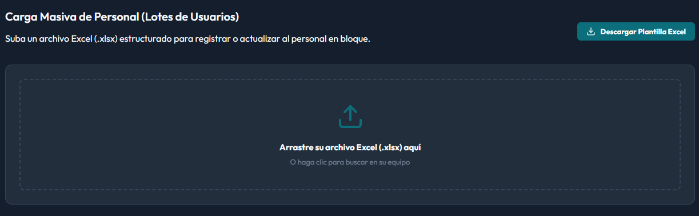

Figura 9: Interfaz inicial de carga masiva

El sistema le indicará errores encontrados en determinadas filas, como por ejemplo dnis repetidos o ausencia de dni.

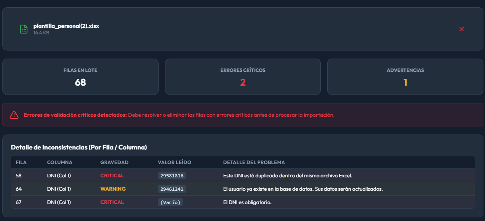

Figura 10: Imagen de detalles con errores del procesamiento en lote

Usted puede utilizar el editor en caliente para poder resolver estos errores, de esta forma se evita corregir el archivo subido. Utilice el botón del lápiz para editar o el botón rojo en forma de tacho de basura para eliminar el registro.

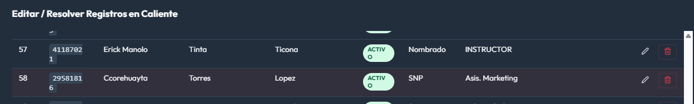

Figura 11: Imagen del editor de registros en caliente

Finalmente presionar el botón de confirmar e importar personal para añadir a todos los usuarios de la plantilla.

## 9. GESTIÓN DE OPERADORES Y SEGURIDAD DEL SISTEMA

Este módulo permite al personal con privilegios de nivel admin auditar, dar de alta, modificar o remover las credenciales de los distintos tipos de usuarios que interactúan con el ecosistema INFOUNSA.

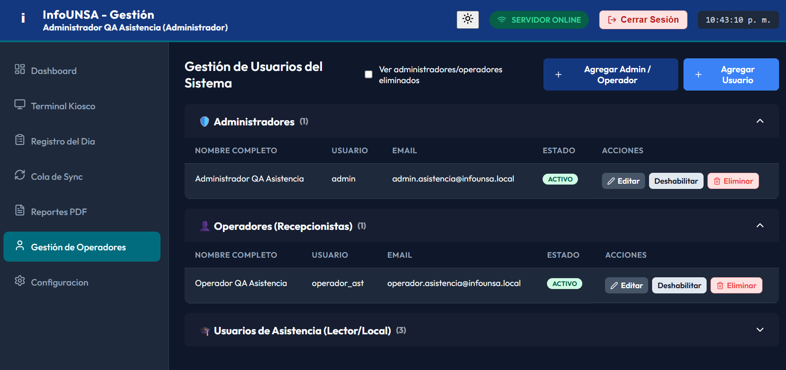

Figura 9. Imagen de Vista del panel de Gestión de Usuarios del Sistema

### 9.1. Jerarquía y Clasificación de Cuentas

La interfaz organiza las cuentas en bloques desplegables independientes según su nivel de autorización y entorno de uso:

- Administradores: Personal técnico o de supervisión global. Tienen acceso total a los paneles de configuración de red, interoperabilidad y control de operadores.
- Operadores (Recepcionistas): Usuarios encargados de la supervisión de las terminales periféricas. Tienen permisos para gestionar el quiosco, forzar sincronizaciones locales y revisar las marcaciones de la jornada.
- Usuarios de Asistencia (Lector/Local): Registro base de los empleados, docentes o estudiantes asignados a esa terminal para registrar sus jornadas mediante el lector periférico.

### 9.2. Herramientas y Acciones Administrativas

En la barra superior derecha se ubican los controles para la creación de nuevos accesos:

- Agregar Admin / Operador: Abre el formulario de credenciales seguras para dar de alta personal que operará la interfaz del software.
- Agregar Usuario: Registra un nuevo DNI/Carnet en la base de datos para habilitar su marcación en el quiosco lector.
- Casilla "Ver administradores/operadores eliminados": Caja de verificación técnica para auditar cuentas que fueron removidas con anterioridad, permitiendo su restauración o revisión histórica.

### 9.3. Panel de Operaciones por Cuenta (Acciones)

Cada fila dentro de las tablas provee información detallada (Nombre Completo, Usuario, Email y Estado) junto con tres herramientas de administración en tiempo real:

- Editar (Botón Gris): Permite corregir nombres, actualizar direcciones de correo electrónico institucional o restablecer contraseñas bloqueadas.
- Deshabilitar (Botón Blanco): Suspende momentáneamente el acceso del usuario al sistema sin borrar sus datos. El indicador de ESTADO cambiará de ACTIVO a SUSPENDIDO
- Eliminar (Botón Rojo con icono de papelera): Remueve la cuenta de la lista activa del sistema, enviándola de forma segura al repositorio de bajas.

## 10. CONFIGURACIÓN DEL SISTEMA Y AJUSTES DE RED

El módulo Configuración es el núcleo técnico de la aplicación. Está dividido en bloques específicos para asegurar la interoperabilidad del ecosistema:

### 10.1. Ajustes de Perfil y Preferencias

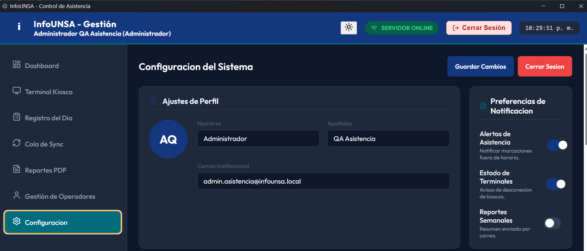

Figura 10. Imagen superior del módulo ajustes de perfil

- Datos del Operador: Muestra de forma transparente los Nombres, Apellidos y Correo Institucional del usuario activo.
- Preferencias de Notificación: Paneles de interruptores (toggles) para activar o desactivar alertas críticas en tiempo real:
    - Alertas de Asistencia: Notifica marcaciones fuera de horario.
    - Estado de Terminales: Avisos automáticos de desconexión de quioscos.
    - Reportes Semanales: Resúmenes automáticos enviados por correo.

### 10.2. Interoperabilidad, Sincronización y Red

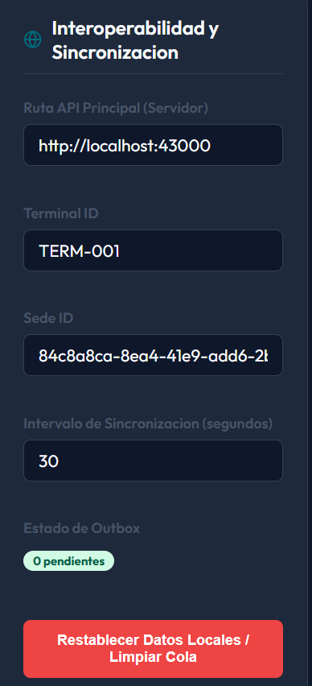

Figura 11: Imagen de interoperabilidad y sincronización

- Ruta API Principal (Servidor): Campo crítico que enlaza la aplicación con el Backend local. Por defecto se establece en http://localhost:43000.
- Terminal ID & Sede ID: Identificadores únicos basados en tokens UUID que enlazan el hardware físico con el registro de sedes de la institución (por ejemplo, TERM-001).
- Intervalo de Sincronización: Define cada cuántos segundos la aplicación intenta comunicarse en segundo plano con el servidor central (configurado de fábrica en 30 segundos).
- Restablecer Datos Locales / Limpiar Cola: Botón de contingencia color rojo. (¡Atención! Solo debe usarse bajo supervisión técnica, ya que purga la memoria local de la terminal).

### 10.3. Gestión de Quioscos Periféricos y Usuarios

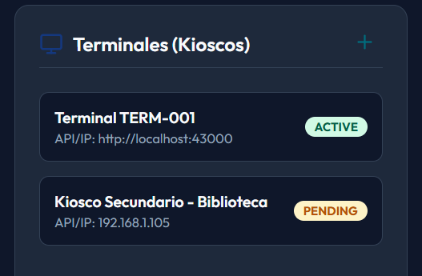

Figura 12: Imagen del bloque de terminales

- Terminales (Kioscos): Lista el estado de los puntos de control del campus. Muestra la IP de red de cada quiosco y su etiqueta de disponibilidad en tiempo real (ACTIVE en verde o PENDING en naranja).

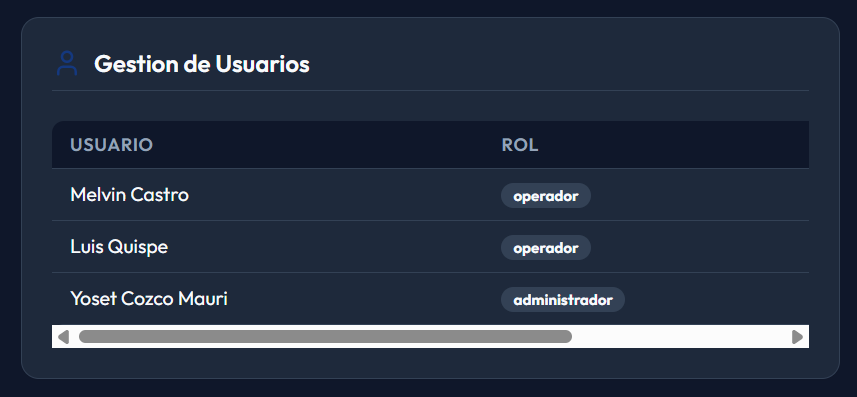

Figura 13. Imagen del bloque de gestión de usuarios

- Gestión de Usuarios: Panel administrativo inferior que lista las cuentas registradas en la base de datos local con sus respectivos roles del sistema (operador o administrador), permitiendo auditar quiénes tienen autorización para manipular la terminal de asistencia.

## 11. GUÍA DE RESOLUCIÓN DE PROBLEMAS

Esta sección permite al operador resolver las contingencias más comunes antes de escalar el caso al Administrador de Redes o Soporte Técnico.

| Problema | Causa Posible | Acción Correctiva |
| --- | --- | --- |
| El indicador de la cabecera se mantiene en SERVIDOR OFFLINE | El servicio backend local en el puerto 43000 está detenido o se cayó. | 1. Verifique que el servidor esté ejecutándose. |
| El lector de código de barras/QR no escribe el DNI automáticamente | El foco del cursor está fuera de la caja de texto o el dispositivo se desconfiguró. | 1. Haga clic directamente dentro del campo de texto DNI / Carnet. 2. Desconecte y vuelva a conectar el cable USB del lector periférico. |
| Aparece un número en la "Cola Offline" y no se borra | La aplicación perdió conectividad momentánea con la base de datos principal al momento de la marcación. | 1. Verifique que el indicador superior esté en ONLINE. 2. Ingrese a Cola de Sync y presione el botón "Subir Cola" para forzar el envío. |
| Error "Credenciales Inválidas" al iniciar sesión con el usuario admin | Se ingresó una contraseña incorrecta o la base de datos local está vacía (sin registros semilla). | 1. Revise que la tecla Bloq Mayús esté apagada. 2. Si es una instalación limpia, asegúrese de haber ejecutado el script de inyección de datos semilla (seed) en MySQL. |

## 12. PROTOCOLO DE REINICIO DE EMERGENCIA Y CONTINGENCIA

Si la aplicación de escritorio experimenta un congelamiento crítico o el sistema operativo no responde al lector de códigos, ejecute el siguiente procedimiento en orden estricto:

### 12.1. Cierre seguro de la aplicación:

- Paso 1. Haga clic en el botón "Cerrar Sesión" en la esquina superior derecha y cierre la ventana ejecutable (.exe). Nunca fuerce el apagado de la computadora con la aplicación procesando marcas.

### 12.2. Reinicio del hardware periférico:

- Paso 2. Desconecte el lector físico de DNI o la cámara web del puerto USB, espere 5 segundos y vuelva a conectarlos en un puerto directo (preferentemente USB 3.0, de color azul).

### 12.3. Relanzamiento del sistema:

- Paso 3. Abra nuevamente el acceso directo de INFOUNSA Asistencia, verifique que el monitor marque SERVIDOR ONLINE e inicie sesión para continuar con el turno.

## 13. ANEXO TÉCNICO: ARQUITECTURA DE DESPLIEGUE

Para el personal de TI e infraestructura, se detallan los parámetros de entorno bajo los cuales opera de manera nativa la distribución compilada:

- Arquitectura del Proyecto: Monorepo (Frontend Desktop, Backend API, Database Service).
- Binario Ejecutable: .exe de producción generado mediante script automatizado de PowerShell.
- Enlace de Interoperabilidad Principal: http://localhost:43000 (Puerto asignado a la API local).
- Motor de Base de Datos: MySQL / Postgres .
- Intervalo del Latido de Conexión (Heartbeat): Cada 30 segundos automáticos.
