# Manual de Usuario — Sistema de Inventario

**Plataforma InfoUNSA**

## INTRODUCCIÓN Y REQUISITOS

### Sobre la Plataforma INFOUNSA - Módulo de Inventario

La aplicación de escritorio INFOUNSA Inventario es el componente visual (Frontend) diseñado para la gestión y captura del registro de ingresos, salidas y permanencia del personal de la institución. Este sistema trabaja de manera híbrida: procesa y valida los datos de forma local a través de una base de datos segura y se comunica en tiempo real con los servidores centrales de INFOUNSA mediante servicios web (API) dedicados para consolidar la información.

### Requisitos Mínimos del Sistema Operativo

Para garantizar un rendimiento fluido del escáner y la correcta persistencia de las marcaciones, la estación de trabajo debe cumplir con los siguientes requerimientos:

- Sistema Operativo: Windows 10 o Windows 11 (Arquitectura de 64 bits).
- Memoria RAM: Mínimo 4 GB (Se recomiendan 8 GB para un procesamiento de video más ágil).
- Hardware Requerido: Cámara web integrada o externa (USB) con resolución mínima de 720p (HD) para el correcto funcionamiento del lector visual.
- Conectividad: Red local (LAN) o Wifi con visibilidad hacia el servidor de la base de datos central.

### Proceso de Instalación del Ejecutable (.exe)

El despliegue de la aplicación se realiza mediante un instalador único automatizado. Siga estos pasos para añadir el programa al equipo:

- Localice el archivo instalador generado por el equipo técnico: InfoUNSA-Inventario-Setup-1.3.5-x64.exe.
- Haga doble clic sobre el archivo para iniciar el inventario de instalación.
- El instalador preparará el entorno de Electron de forma automática. El asistente le permitirá elegir la carpeta de instalación (puede aceptar la que propone por defecto) y creará los accesos directos.
- Una vez finalizada la copia de archivos, el sistema creará un acceso directo en el Escritorio de Windows y en el Menú de Inicio con el nombre InfoUNSA-Inventario.
- **Actualización o reinstalación:** ejecute el nuevo instalador sobre el existente. Sus datos locales (marcaciones o movimientos pendientes de sincronizar, sesión y configuración) se conservan y **no debe eliminar nada**. Solo si el equipo técnico le indica una instalación completamente limpia (se perderán los registros locales no sincronizados), elimine la carpeta infounsa-inventario-desktop, ubicada en:

`C:\Users\<nombre_de_usuario>\AppData\Roaming`

También puede acceder a esta ubicación presionando Windows + R, escribiendo %APPDATA% y presionando Enter.

### Primer Inicio de la Aplicación en Windows

Al abrir la aplicación por primera vez, el sistema cargará los módulos base en la memoria de la computadora y ejecutará una prueba de comunicación hacia el servidor local (mapeado al puerto base del sistema). Si la infraestructura central está activa, la interfaz gráfica mostrará inmediatamente el formulario de inicio de sesión seguro.

## CONTROL DE ACCESOS Y SEGURIDAD

### Interfaz de Autenticación (Login)

Al iniciar la aplicación, se desplegará la ventana de acceso seguro. La interfaz es minimalista y está diseñada para que el operador valide su identidad antes de manipular los datos de asistencia.

Para ingresar al sistema, realice los siguientes pasos:

- Campo Usuario: Escriba el nombre de usuario asignado por el área de sistemas (por ejemplo, admin o su identificador de operador).
- Campo Contraseña: Introduzca la clave de seguridad correspondiente. Por motivos de protección, los caracteres se ocultarán automáticamente.
- Botón Entrar: Haga clic en el botón "Entrar" (o presione la tecla Enter en su teclado) para validar las credenciales e ingresar al panel principal.

### Estado del Servidor (Indicador de Conectividad)

En esta misma pantalla de inicio de sesión, el sistema cuenta con un monitor inteligente de conectividad en tiempo real. Antes de intentar escribir sus datos, el operador siempre debe revisar el estado del indicador visual:

- Indicador Verde (ONLINE): Significa que la aplicación de escritorio se está comunicando con éxito con el servidor central de la plataforma. Puede iniciar sesión normalmente.
- Indicador Rojo (OFFLINE): Significa que la aplicación no puede detectar el servidor central. El botón de ingresar podría deshabilitarse o arrojar un error inmediato.

### Procedimiento ante Fallas de Inicio de Sesión o Conexión

Si al intentar ingresar el sistema experimenta problemas, siga este protocolo de soporte básico:

- Si el indicador está en ROJO:
    - Verifique que la computadora tenga acceso a la red local.
    - Asegúrese de que el servidor central esté encendido y corriendo en la dirección configurada.
    - Configure correctamente la dirección del servidor haciendo uso del menú desplegable Configuración del Servidor haciendo clic en en la rueda de configuración en la parte superior derecha.
- Si el indicador está en VERDE pero da "Error de Credenciales":
    - Revise que la tecla de mayúsculas (Bloq Mayús) no esté activa por error.
    - Recuerde que el usuario inicial de administración del sistema (admin) usa la contraseña definida por el equipo técnico en la instalación (en una instalación nueva, por defecto, `admin123`; se recomienda cambiarla tras el primer ingreso). Si la ha olvidado, solicite un restablecimiento al equipo técnico.

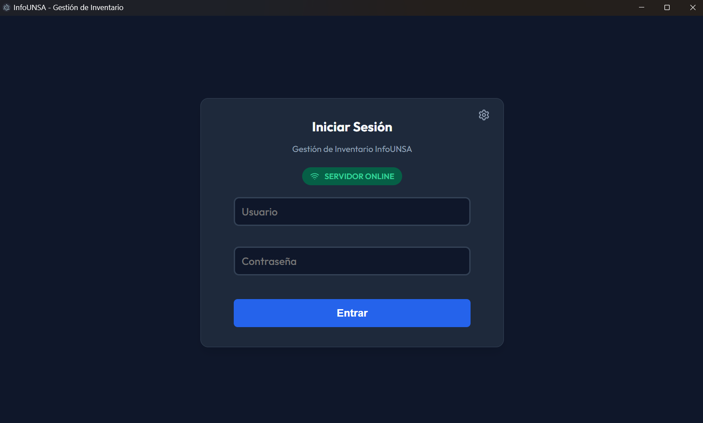

Figura 1: Inicio de sesión del sistema inventario.

## PANEL PRINCIPAL (RESUMEN GENERAL)

Al iniciar sesión exitosamente, el sistema despliega el Resumen General de Almacén, el cual funciona como el centro de control principal. Esta pantalla ofrece una vista panorámica del estado del inventario, alertas de escasez y el volumen de operaciones en tiempo real.

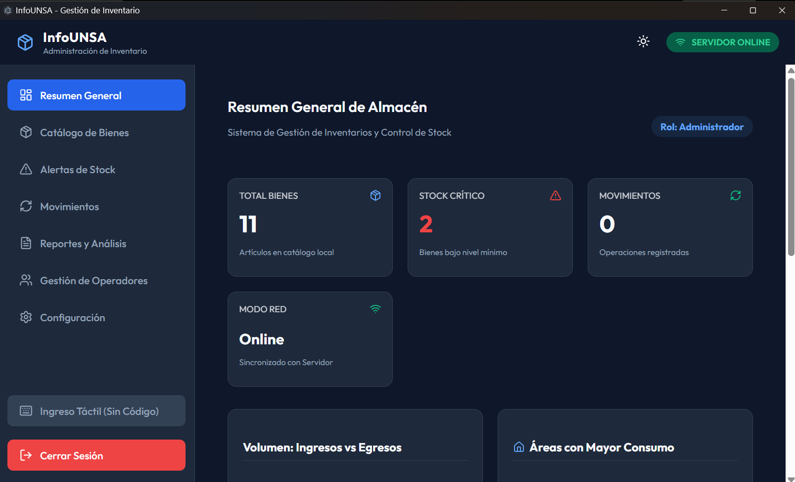

FIgura 2: Vista general del Dashboard con las tarjetas de indicadores

### Menú de Navegación Lateral

Ubicado en la franja izquierda de la pantalla, este menú proporciona acceso directo a todos los módulos funcionales del sistema de inventario:

- Resumen General: Panel actual de métricas y alertas.
- Catálogo de Bienes: Gestión del maestro de artículos, categorías y niveles de stock.
- Alertas de Stock: Módulo dedicado al control preventivo de desabastecimiento.
- Movimientos: Registro central de entradas (ingresos) y salidas (egresos) de mercancía.
- Reportes y Análisis: Generador de documentos y exportación de datos.
- Gestión de Operadores: Administración de cuentas y roles de usuario.
- Configuración: Parámetros técnicos del sistema.
- Ingreso Táctil (Sin Código): Interfaz rápida para registro de operaciones mediante pantalla táctil.

### Indicadores Principales de Almacén (KPIs)

En la parte superior, el sistema presenta cuatro tarjetas de resumen estadístico que se actualizan dinámicamente:

- TOTAL BIENES (Caja Azul): Muestra la cantidad total de artículos únicos registrados actualmente en el catálogo local.
- STOCK CRÍTICO (Caja Roja): Indica el número de bienes cuyo inventario actual ha caído por debajo del nivel mínimo establecido, requiriendo atención inmediata.
- MOVIMIENTOS (Caja Verde): Contabiliza el número total de operaciones logísticas (ingresos y salidas) registradas en el periodo actual.
- MODO RED: Confirma el estado de conexión del cliente de escritorio con el servidor central. El estado "Online" garantiza que los movimientos se están sincronizando correctamente.

### Estadísticas de Flujo y Rotación

En la sección media del panel, se encuentran tres módulos analíticos diseñados para evaluar el comportamiento del inventario:

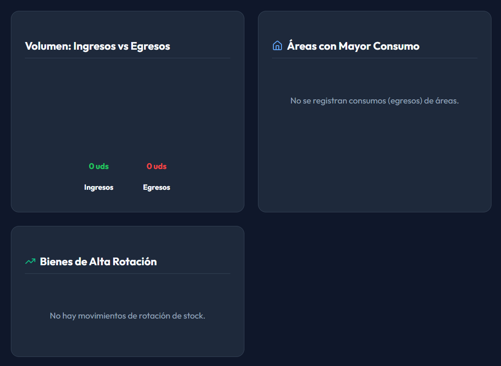

Figura 3: Módulos de Volumen, Áreas de Consumo y Alta Rotación

- Volumen: Ingresos vs Egresos: Compara gráficamente las cantidades de unidades que han entrado al almacén frente a las que han sido despachadas.
- Áreas con Mayor Consumo: Identifica qué departamentos o áreas de la institución están solicitando o consumiendo la mayor cantidad de bienes.
- Bienes de Alta Rotación: Destaca aquellos artículos que tienen un flujo de movimiento constante y rápido, ayudando a prever compras futuras.

### Alertas de Reposición Urgente

En la parte inferior, el Dashboard incluye una tabla de acción inmediata diseñada para el equipo de compras o logística.

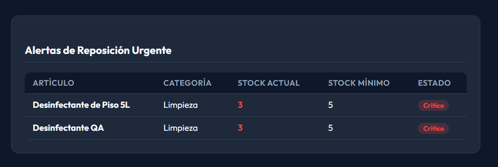

Figura 4: Tabla de Alertas de Reposición Urgente

Esta grilla filtra y aísla automáticamente todos los artículos que se encuentran en estado "Crítico". Presenta la información desglosada en las siguientes columnas:

- Artículo: Nombre descriptivo del producto (ej. Desinfectante de Piso 5L).
- Categoría: Familia a la que pertenece el bien (ej. Limpieza).
- Stock Actual: Cantidad física disponible en este momento (resaltada en color rojo para denotar la urgencia).
- Stock Mínimo: El umbral límite configurado para ese producto. Si el stock actual es igual o menor a este número, se dispara la alerta.
- Estado: Etiqueta visual de confirmación de escasez (Crítico).

## CATÁLOGO DE BIENES

Este módulo funciona como el registro maestro del inventario. Permite a los administradores visualizar, buscar y gestionar todos los artículos registrados en la base de datos local de la institución.

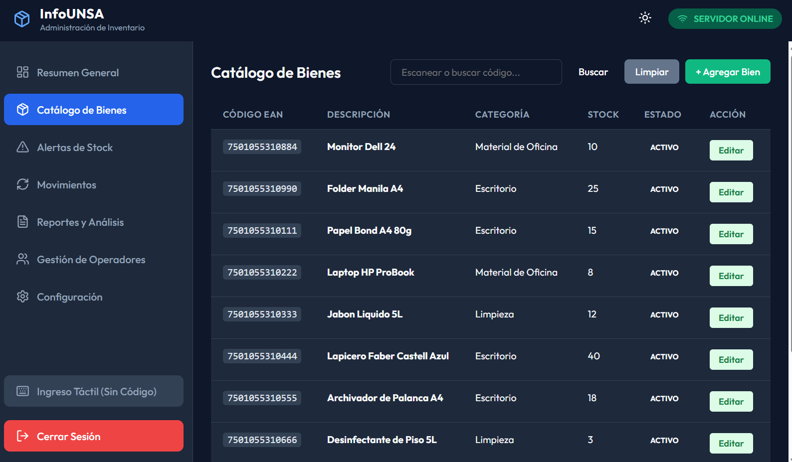

Figura 5: Vista principal del Catálogo de Bienes con la tabla de registros

### Herramientas de Búsqueda y Control

En la parte superior derecha del panel, el sistema proporciona herramientas rápidas para localizar productos específicos o registrar nueva mercancía:

- Barra de Búsqueda ("Escanear o buscar código..."): Campo de texto dual. Permite al operador escribir manualmente el nombre del producto o, para mayor agilidad, usar un lector de código de barras físico para escanear el producto directamente.
- Botón "Buscar": Ejecuta la consulta y filtra la tabla inferior según el texto o código ingresado.
- Botón "Limpiar": Borra el filtro de búsqueda actual y vuelve a cargar la lista completa de bienes.
- Botón "+ Agregar Bien" (Verde): Abre el formulario para dar de alta un artículo completamente nuevo en la base de datos del sistema

### Estructura de la Tabla de Registros

La información de la mercancía se organiza en una cuadrícula de lectura rápida que muestra los datos más relevantes de cada artículo. Cada fila contiene las siguientes columnas:

- CÓDIGO EAN: Muestra el identificador numérico único (código de barras) asignado al artículo (ej. 7501055310884).
- DESCRIPCIÓN: Nombre comercial o técnico del bien registrado (ej. Monitor Dell 24, Papel Bond A4 80g).
- CATEGORÍA: Familia o departamento al que pertenece el producto (ej. Material de Oficina, Escritorio, Limpieza), útil para la segmentación en los reportes.
- STOCK: Refleja la cantidad de unidades físicas disponibles actualmente en el almacén.
- ESTADO: Indica si el producto está ACTIVO para ser utilizado en nuevas operaciones y movimientos.
- ACCIÓN (Botón "Editar"): Permite al operador abrir la ficha técnica del producto seleccionado para modificar su información, corregir su categoría o actualizar sus parámetros de stock mínimo.

### Formulario de Registro y Edición de Bienes

Al hacer clic en el botón "+ Agregar Bien" (o al intentar "Editar" un registro existente), el sistema superpone una ventana modal denominada "Registrar Nuevo Bien". Este formulario estructura la ficha técnica del producto en la base de datos.

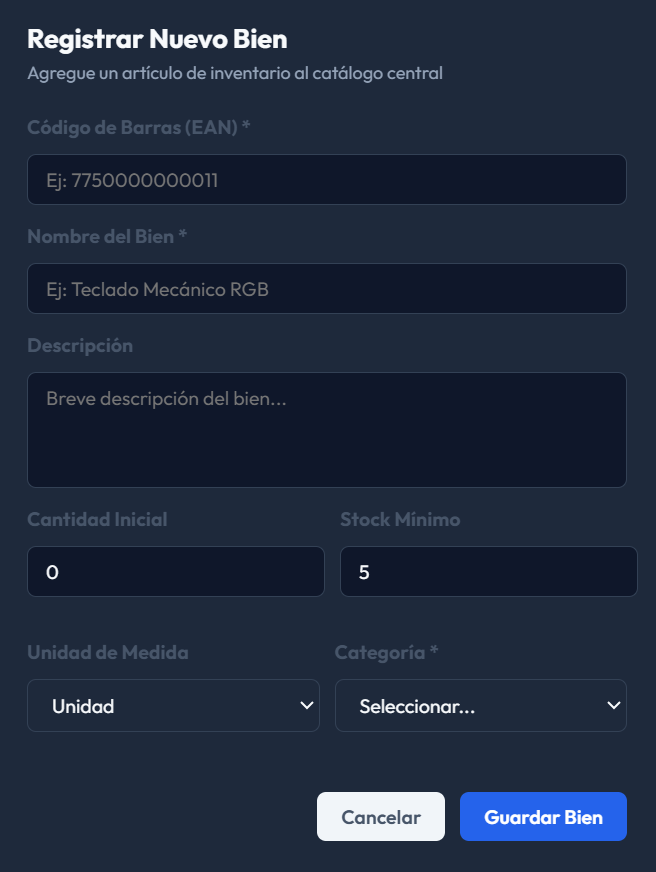

FIgura 6: Ventana modal de "Registrar Nuevo Bien" con sus campos

El formulario está dividido en los siguientes campos de captura. Los campos marcados con un asterisco (*) son de llenado obligatorio para garantizar la integridad de la base de datos:

- Código de Barras (EAN) *: Identificador numérico único del producto. Puede ingresarse manualmente usando el teclado o, de manera más eficiente, disparando el lector de código de barras directamente sobre este campo.
- Nombre del Bien *: Denominación principal del artículo (ej. Teclado Mecánico RGB). Debe ser claro y estandarizado para facilitar su búsqueda.
- Descripción: Campo de texto libre y opcional. Permite añadir características adicionales, marcas, modelos o especificaciones técnicas del producto.
- Cantidad Inicial: Define el stock físico al momento de crear el producto. Por defecto inicia en 0, asumiendo que el stock real ingresará posteriormente a través del módulo de "Movimientos".
- Stock Mínimo: Parámetro crítico (por defecto en 5). Establece el umbral de alerta; si el inventario de este producto cae por debajo de este número, el sistema disparará automáticamente una advertencia visual en el Dashboard principal.
- Unidad de Medida: Menú desplegable para definir cómo se contabiliza el producto (ej. Unidad, Cajas, Litros, Paquetes).
- Categoría *: Selector obligatorio para clasificar el bien dentro de las familias del almacén (ej. Material de Oficina, Limpieza), vital para la correcta estructuración de los reportes.

Acciones del Formulario:

Una vez completados los datos, el operador cuenta con dos botones en la parte inferior:

- Guardar Bien (Botón Azul): Valida los campos obligatorios y registra el producto en la base de datos central, actualizando inmediatamente el catálogo.
- Cancelar (Botón Blanco): Cierra la ventana modal descartando cualquier cambio o texto ingresado, regresando a la vista del catálogo.

## ALERTAS DE STOCK

El módulo de Alertas de Stock funciona como un panel de prevención de desabastecimiento. Su objetivo principal es aislar y mostrar únicamente aquellos productos que requieren atención inmediata por parte del equipo de compras o logística.

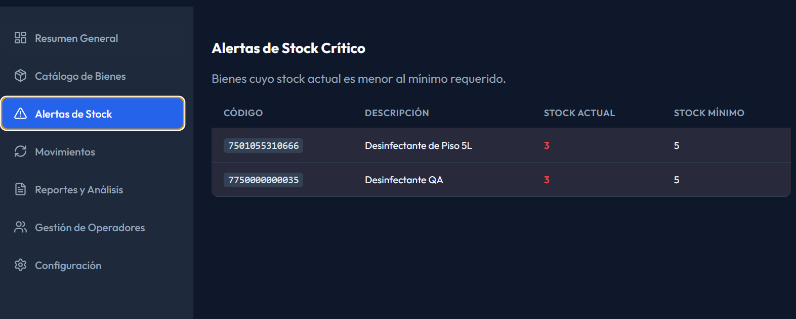

Figura 7: Vista principal del panel de Alertas de Stock Crítico

### Funcionamiento del Panel

Esta pantalla actúa como una versión expandida y dedicada de la tabla de alertas rápidas que se encuentra en el Dashboard principal. El sistema monitorea constantemente el catálogo y filtra de forma automática los "Bienes cuyo stock actual es menor al mínimo requerido".

Si el inventario físico de un artículo (registrado en sus movimientos) cae por debajo del límite que se configuró en el campo "Stock Mínimo" durante su creación, el producto aparecerá inmediatamente en esta lista.

### Estructura de la Información

La tabla de alertas presenta los datos estrictamente necesarios para identificar y reponer la mercancía faltante:

- CÓDIGO: Muestra el identificador EAN del producto (ej. 7501055310666), facilitando su búsqueda rápida en catálogos de proveedores o en el propio sistema.
- DESCRIPCIÓN: Nombre comercial o técnico del artículo que está en escasez.
- STOCK ACTUAL (Texto Rojo): Refleja la cantidad física disponible en el momento. El sistema resalta este número en color rojo brillante para enfatizar el estado crítico de desabastecimiento.
- STOCK MÍNIMO: Muestra el umbral de seguridad configurado para dicho producto. Sirve como referencia para saber cuántas unidades, como mínimo, se deberían adquirir para salir de la zona de riesgo.

Nota Operativa: Este panel es de solo lectura. Para retirar un producto de esta lista de alertas, el operador debe generar un ingreso de mercancía en el módulo de Movimientos que eleve el "Stock Actual" por encima del "Stock Mínimo".

## GESTIÓN DE MOVIMIENTOS DE ALMACÉN

El módulo de Movimientos es el núcleo operativo del sistema de inventario. Aquí se registra toda la actividad logística diaria, permitiendo a los operadores sumar mercancía al stock (ingresos por compras o devoluciones) o restar unidades (egresos por consumo, despacho o mermas).

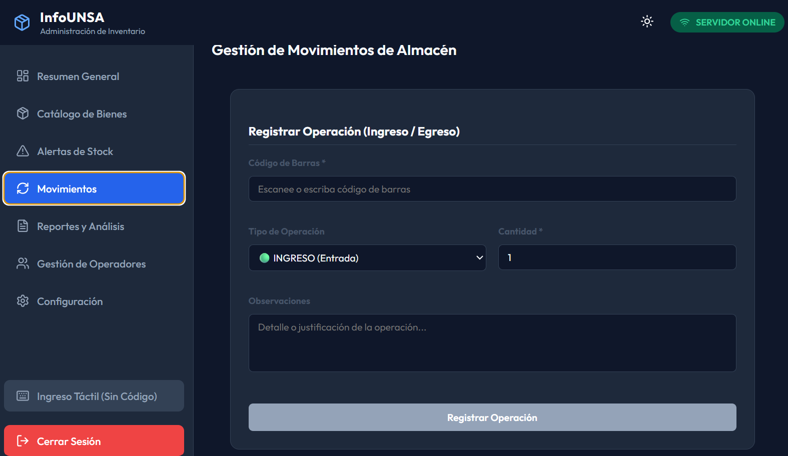

Figura 8: Formulario superior de "Registrar Operación"

### Formulario de Registro de Operación (Ingreso / Egreso)

La sección superior de la pantalla presenta un formulario optimizado para registrar transacciones de forma rápida y sin fricciones. Los campos marcados con un asterisco (*) son obligatorios:

- Código de Barras *: Campo principal de identificación. El operador puede utilizar un lector óptico para escanear el producto o teclear el código manualmente. El sistema cruzará esta información con el Catálogo de Bienes para identificar el artículo.
- Tipo de Operación: Menú desplegable que define la naturaleza matemática del movimiento:
    - INGRESO (Entrada): Suma la cantidad indicada al stock actual del producto.
    - EGRESO (Salida): Resta la cantidad indicada del stock actual.
- Cantidad: Número entero que representa cuántas unidades físicas del artículo están entrando o saliendo del almacén.
- Observaciones: Campo de texto libre fundamental para la auditoría. Permite detallar la justificación del movimiento, el número de orden de compra, el área que solicita el material o el motivo de una salida excepcional.

Ejecución:

Una vez verificados los datos, el botón inferior "Registrar Operación" procesa el movimiento. Si es un egreso, el sistema validará internamente que exista stock suficiente antes de autorizar la salida.

### Historial Completo de Operaciones Recientes

En la mitad inferior de la pantalla se encuentra la bitácora de auditoría en tiempo real. Cada vez que se registra una operación exitosa en el formulario superior, esta tabla se actualiza automáticamente agregando una nueva fila.

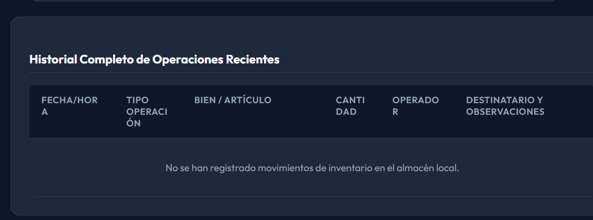

Figura 9: Tabla inferior de "Historial Completo de Operaciones Recientes"

Esta grilla es esencial para la trazabilidad y muestra el desglose exacto de cada movimiento:

- FECHA/HORA: Sello de tiempo exacto en el que la transacción impactó la base de datos.
- TIPO OPERACIÓN: Confirmación visual de si fue un Ingreso o un Egreso.
- BIEN / ARTÍCULO: Nombre descriptivo del producto afectado.
- CANTIDAD: Volumen de unidades movilizadas.
- OPERADOR: Identificación del usuario o cuenta de sistema que ejecutó la acción (ej. Administrador de Inventario), vital para establecer responsabilidades.
- DESTINATARIO Y OBSERVACIONES: Refleja el texto ingresado en el campo de justificación durante el registro de la operación.

## REPORTES Y ANÁLISIS AVANZADOS

El módulo de Reportes y Análisis permite consolidar la información histórica de todas las entradas y salidas del almacén. Es la herramienta principal para auditorías, cierres de mes y exportación de datos a formatos manejables (PDF y Excel).

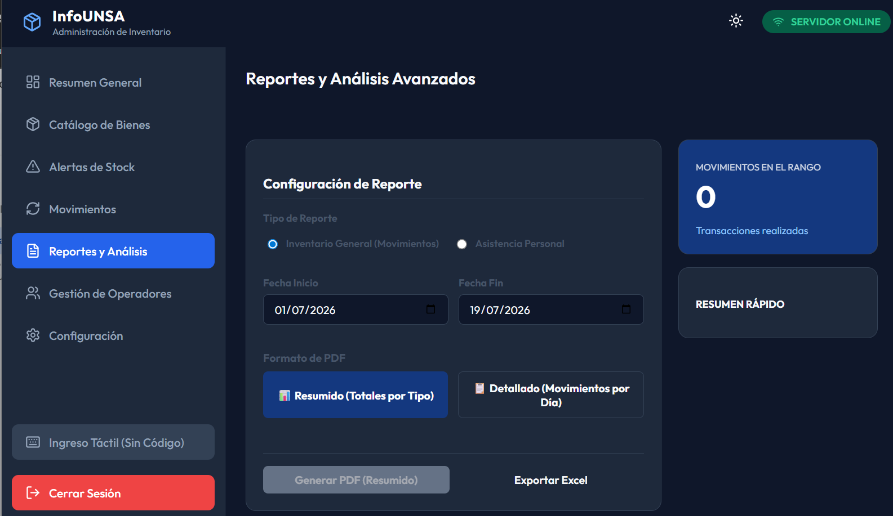

Figura 10: Vista superior de la "Configuración de Reporte"

### Configuración de Parámetros

Para emitir un documento, el operador debe estructurar la consulta utilizando el panel de Configuración de Reporte:

- Tipo de Reporte: Permite seleccionar el origen de los datos. Por defecto, se utiliza Inventario General (Movimientos).
- Rango de Fechas: Dos selectores de calendario obligatorios (Fecha Inicio y Fecha Fin) que delimitan el periodo de tiempo exacto que el sistema va a auditar.
- Formato de PDF: Define el nivel de profundidad de la información a exportar:
    - Resumido (Totales por Tipo): Agrupa y suma las cantidades totales de ingresos y egresos por producto, ideal para una visión general del mes.
    - Detallado (Movimientos por Día): Desglosa cronológicamente cada transacción individual registrada en el sistema, mostrando la fecha, hora y operador.

Nota: Al lado derecho de la configuración, el panel "MOVIMIENTOS EN EL RANGO" actúa como un contador dinámico que le indica al usuario cuántas transacciones existen en las fechas seleccionadas antes de generar el reporte.

### Opciones de Exportación y Validación

Una vez configurados los parámetros, el operador cuenta con dos vías de exportación en la parte inferior del bloque:

- Generar PDF: Crea un documento formal y no editable, ideal para impresión y firmas. El texto del botón cambia dinámicamente según el formato elegido (Resumido o Detallado).
- Exportar Excel: Descarga los datos crudos en una hoja de cálculo (.xlsx), permitiendo al equipo de logística realizar cruces de información, gráficos o tablas dinámicas propias.

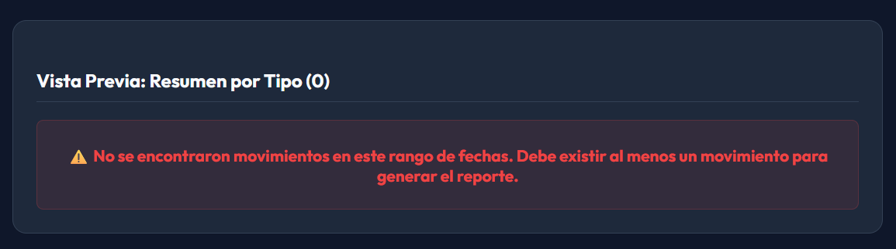

Figura 11: Vista inferior con la Alerta de Vista Previa.

Motor de Validación (Vista Previa):

Para optimizar el uso del servidor y evitar archivos vacíos, el sistema bloquea la generación de reportes si no existen datos. Si el rango de fechas seleccionado tiene "0 Transacciones", el botón de PDF se deshabilitará y se mostrará una alerta roja:

"No se encontraron movimientos en este rango de fechas. Debe existir al menos un movimiento para generar el reporte."

### Historial de Reportes PDF Generados

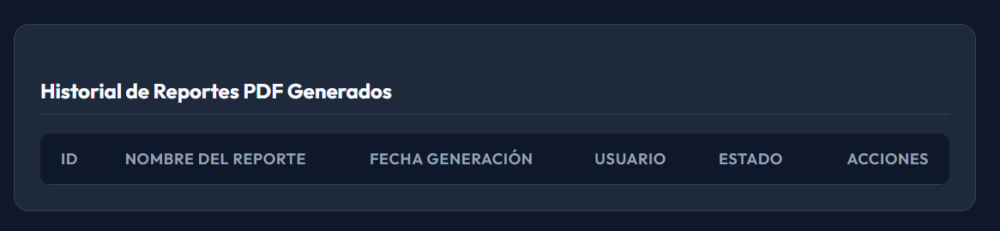

Figura 12: Vista inferior del Historial de Reportes.

En la parte inferior de la pantalla se encuentra una tabla de registro histórico. Cada vez que un usuario genera exitosamente un documento PDF, el sistema guarda una copia y deja un rastro de auditoría con la siguiente información:

- ID: Número de identificación único del reporte.
- NOMBRE DEL REPORTE: Título autogenerado que incluye el periodo consultado.
- FECHA GENERACIÓN: Momento exacto en el que se solicitó el documento.
- USUARIO: Cuenta que ordenó la creación del reporte.
- ESTADO y ACCIONES: Permite verificar si el documento se generó correctamente y ofrece la opción de volver a descargarlo sin necesidad de procesar la consulta nuevamente.

## GESTIÓN DE USUARIOS Y OPERADORES

Este módulo está diseñado para centralizar el control de accesos a la plataforma de Inventario. Permite al personal autorizado crear nuevas credenciales, auditar al equipo de trabajo y definir qué nivel de permisos tiene cada integrante dentro del sistema.

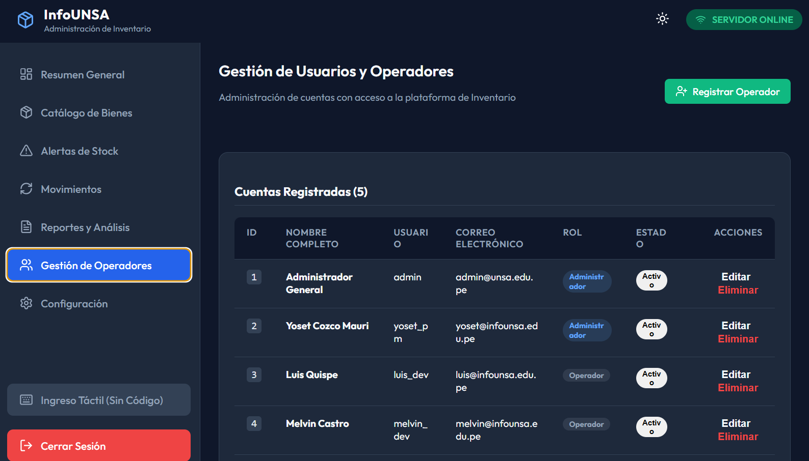

Figura 13: Vista principal de Gestión de Usuarios y Operadores.

### Alta de Nuevos Accesos

En la esquina superior derecha de la interfaz se ubica el botón de acción principal:

- Registrar Operador (Botón Verde): Al presionarlo, el sistema despliega el formulario de registro donde se ingresan los datos personales, se establecen las credenciales de inicio de sesión (usuario/contraseña) y se asignan los privilegios de la nueva cuenta.

### Panel de Cuentas Registradas

El área principal de la pantalla expone una tabla administrativa que lista a todo el personal con acceso al software. Un contador en el encabezado (ej. Cuentas Registradas (5)) muestra el volumen total de trabajadores dados de alta.

La información se desglosa en las siguientes columnas:

- ID: Identificador numérico único asignado a cada trabajador.
- NOMBRE COMPLETO: Nombre y apellido del titular de la cuenta.
- USUARIO: Credencial corta (username) requerida en la pantalla de Login para acceder al sistema (ej. admin, yoset_pm).
- CORREO ELECTRÓNICO: Dirección de contacto institucional vinculada al perfil.
- ROL: Etiqueta visual que define la jerarquía de permisos del usuario dentro de la aplicación. En el sistema coexisten dos niveles:
    - Administrador (Etiqueta Azul): Acceso total e irrestricto a todos los módulos, incluyendo reportes, configuraciones y eliminación de registros.
    - Operador (Etiqueta Gris): Perfil orientado al trabajo logístico diario (registro de movimientos, consultas de stock), con restricciones en módulos sensibles o de configuración técnica.
- ESTADO: Indicador que confirma si la cuenta está habilitada (Activo) para operar o si ha sido suspendida.

### Acciones de Administración

En la extrema derecha de cada fila, la columna ACCIONES proporciona herramientas de gestión rápida e individualizada:

- Editar: Permite abrir nuevamente la ficha del usuario para actualizar sus datos, corregir su correo, ascender/descender su rol o modificar su contraseña en caso de olvido.
- Eliminar (Texto Rojo): Revoca inmediatamente el acceso de esa cuenta al sistema de inventario y la retira de la lista activa.

Nota de Seguridad: Antes de eliminar a un operador, asegúrese de que sus turnos y operaciones previas hayan sido debidamente auditadas, ya que su nombre quedará en el historial de los movimientos logísticos (entradas/salidas) que haya registrado.

## CONFIGURACIÓN DEL SISTEMA

El módulo de Configuración está destinado exclusivamente al personal con rol de Administrador. En esta sección se gestionan tanto los datos del perfil del usuario como los parámetros técnicos de nivel profundo, incluyendo la seguridad de la base de datos local y la sincronización con los servidores principales.

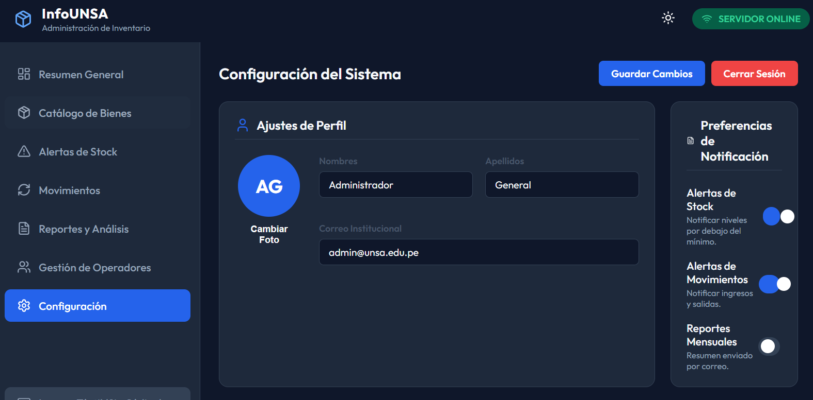

Figura 14. Vista superior de Ajustes de Perfil y Preferencias

### Ajustes de Perfil y Notificaciones

La parte superior de la pantalla permite personalizar la cuenta activa y controlar el flujo de avisos del sistema:

- Ajustes de Perfil: Permite actualizar los Nombres (ej. Administrador), Apellidos (ej. General) y el Correo Institucional (ej. admin@unsa.edu.pe). También incluye la opción para cambiar la foto de perfil del usuario.
- Preferencias de Notificación: Un panel lateral con interruptores (toggles) para activar o desactivar alertas clave:
    - Alertas de Stock: Notifica automáticamente cuando los niveles de un artículo caen por debajo del mínimo establecido.
    - Alertas de Movimientos: Emite notificaciones cada vez que se registran ingresos y salidas en el inventario.
    - Reportes Mensuales: Envía un resumen automatizado por correo electrónico al finalizar el mes.

Una vez realizadas las modificaciones en esta sección, se debe presionar el botón azul "Guardar Cambios" ubicado en la esquina superior derecha.

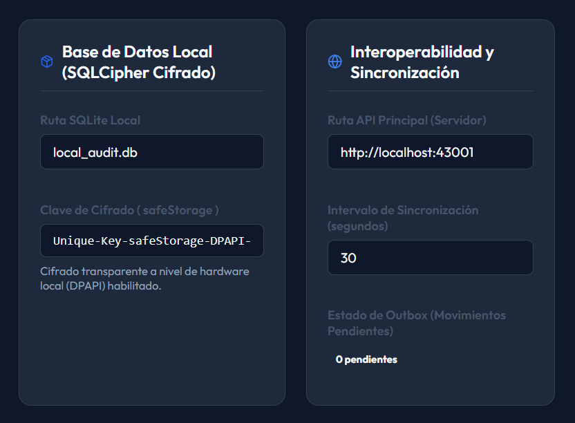

Figura 15: Vista central de Base de Datos y Sincronización

### Seguridad y Base de Datos Local

Para garantizar la integridad de la información en entornos sin conexión, el sistema cuenta con el panel Base de Datos Local (SQLCipher Cifrado).

- Ruta SQLite Local: Indica el nombre y ubicación del archivo de la base de datos en el equipo (por defecto, local_audit.db).
- Clave de Cifrado (safeStorage): Muestra de forma ofuscada la llave criptográfica única del sistema. Esta sección confirma que el "Cifrado transparente a nivel de hardware local (DPAPI)" se encuent

### Interoperabilidad y Sincronización

Este panel configura la comunicación entre el cliente local y el servidor central en la nube o intranet:

- Ruta API Principal (Servidor): Define la dirección de red a la que el sistema reporta los movimientos (ej. http://localhost:43001).
- Intervalo de Sincronización: Establece la frecuencia, en segundos (ej. 30), con la que el sistema intentará enviar o recibir datos nuevos.
- Estado de Outbox: Monitorea los "Movimientos Pendientes". Si el equipo pierde conexión a internet, los movimientos se almacenan aquí y el contador aumentará; al recuperar la red, se sincronizarán automáticamente y volverá a cero.

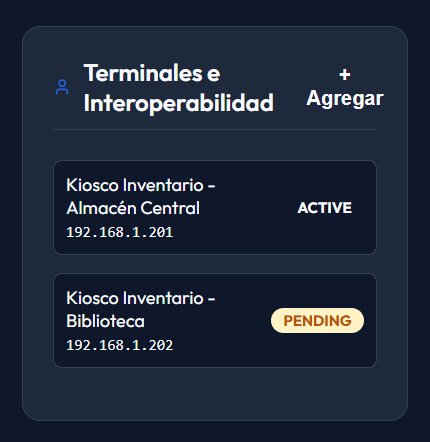

Figura 16: Vista inferior de Terminales e Interoperabilidad

### Gestión de Terminales

En la parte inferior se encuentra la sección de Terminales e Interoperabilidad, la cual permite administrar múltiples puntos de acceso o "Kioscos" conectados a la misma red.

- El botón "+ Agregar" permite vincular una nueva terminal física al ecosistema del almacén.
- La lista muestra los dispositivos configurados, su dirección IP local, y su estado de conexión actual. Por ejemplo, un "Kiosco Inventario - Almacén Central" puede mostrar un estado ACTIVE (conectado), mientras que un "Kiosco Inventario - Biblioteca" puede estar en estado PENDING (esperando conexión o autorización).

## CONTINGENCIA: INGRESO TÁCTIL (SIN CÓDIGO)

El botón ubicado en la parte inferior del menú lateral, denominado "Ingreso Táctil (Sin Código)", despliega una herramienta vital para garantizar la operatividad ininterrumpida del almacén. Se trata de una ventana emergente (modal) diseñada específicamente como un plan de contingencia rápido.

### Propósito y Casos de Uso

Como indica su subtítulo, esta función está estrictamente pensada "Para bienes antiguos o sin etiqueta EAN". Resulta indispensable en los siguientes escenarios:

- Falla de Hardware: El lector de código de barras óptico se avería o se desconecta.
- Etiquetas Dañadas: El código de barras del producto físico está borroso, rasgado o es ilegible para el escáner.
- Inventario Heredado: Se manipulan artículos o bienes antiguos que solo poseen un código numérico interno (SKU) en lugar de un código de barras comercial estándar.

### Interfaz y Botonera Táctil

La interfaz prescinde del teclado físico del ordenador y está optimizada para pantallas táctiles (como los "Kioscos de Inventario" mencionados en el capítulo de Configuración), presentando botones grandes y espaciados para evitar errores de "dedo gordo":

- Campo de Entrada: La barra superior (Ingrese código interno...) refleja los números que el operador va digitando.
- Teclado Numérico (0-9): Botonera de alto contraste para digitar el código identificador del bien.
- Tecla de Retroceso (⌫): Ubicada a la derecha del número cero, permite borrar rápidamente el último dígito ingresado en caso de error.
- Botón "Buscar / Ingresar" (Azul): Es la acción principal. Toma la secuencia numérica digitada y fuerza al sistema a buscar ese identificador en el Catálogo de Bienes para proceder con el movimiento logístico.
- Botón "Cerrar" (Blanco): Cancela la acción actual y oculta la ventana emergente, devolviendo al usuario a la pantalla en la que se encontraba.
