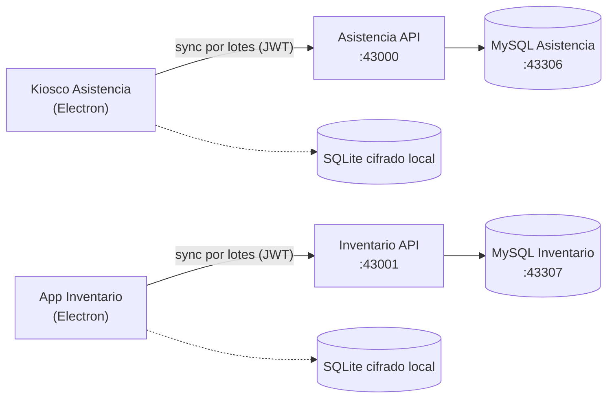

# Plataforma InfoUNSA

Repositorio: <https://github.com/mtinta/infounsa-asistencia-inventario>

Monorepo de la **Plataforma InfoUNSA** (Universidad Nacional de San Agustín de Arequipa): control de asistencia y gestión de inventario.

| Módulo | Qué es | Tecnología |
| :--- | :--- | :--- |
| **Asistencia** | API central + kiosco de escritorio para marcar asistencia de personal y visitantes | NestJS, Prisma, MySQL · Electron, React 19, SQLCipher |
| **Inventario** | API central + aplicación de escritorio para catálogo, movimientos y alertas de stock | NestJS, Prisma, MySQL · Electron, React 19, SQLCipher |

Las aplicaciones de escritorio funcionan **offline-first**: guardan los registros en una base SQLite cifrada (SQLCipher) y los sincronizan por lotes con la API cuando hay conexión.



---

## Contenido

1. [Requisitos](#1-requisitos)
2. [Instalación con Docker](#2-instalación-con-docker)
3. [Instalación sin Docker (MySQL nativo)](#3-instalación-sin-docker-mysql-nativo)
4. [Scripts de servidores](#4-scripts-de-servidores)
5. [Generar instaladores de Windows](#5-generar-instaladores-de-windows)
6. [Notas para Windows](#6-notas-para-windows)
7. [Lista de verificación para producción](#7-lista-de-verificación-para-producción)
8. [Puertos y variables de entorno](#8-puertos-y-variables-de-entorno)
9. [Estructura del repositorio](#9-estructura-del-repositorio)
10. [Documentación y solución de problemas](#10-documentación-y-solución-de-problemas)

---

## 1. Requisitos

| Herramienta | Versión | Para qué |
| :--- | :--- | :--- |
| [Node.js](https://nodejs.org) | 22 LTS o superior | APIs y apps de escritorio |
| [pnpm](https://pnpm.io/installation) | 9 o superior | Instalar dependencias del monorepo (`npm install -g pnpm`) |
| [Docker](https://docs.docker.com/get-docker/) con Compose v2 | 24+ | Bases de datos MySQL (y stack completo) |
| Git | 2.40+ | Clonar el repositorio |

Solo para compilar instaladores de Windows: Windows 10/11 x64 con las *Build Tools* de Visual Studio (carga de trabajo "Desarrollo para escritorio con C++") y Python 3, necesarios para la dependencia nativa `@journeyapps/sqlcipher` si no hay binario precompilado.

---

## 2. Instalación con Docker

Levanta las bases de datos y las APIs de Asistencia e Inventario con un solo comando. Es la opción más simple, pensada para **pruebas, demostración y desarrollo**: `docker-compose.yml` ejecuta las APIs en modo desarrollo (`NODE_ENV=development`, recarga automática) y en cada arranque corre el seed con datos de demostración. **Para producción** usa la instalación nativa con servicios de Windows (secciones 3 y 4, y los [manuales técnicos](Manuales/README.md)) o `docker-compose.prod.yml` con imágenes publicadas por el pipeline de CI; ver la [lista de verificación](#7-lista-de-verificación-para-producción).

```bash
git clone https://github.com/mtinta/infounsa-asistencia-inventario.git
cd infounsa-asistencia-inventario

# 1. Variables de entorno
cp .env.example .env          # PowerShell: Copy-Item .env.example .env
```

Edita `.env` y completa **todas** las contraseñas y secretos (están vacíos a propósito):

- `ASISTENCIA_DB_PASSWORD`, `ASISTENCIA_DB_ROOT_PASSWORD`, `INVENTARIO_DB_PASSWORD`, `INVENTARIO_DB_ROOT_PASSWORD`
- `JWT_SECRET`, `JWT_SECRET_INVENTARIO` (cadenas largas y aleatorias)
- (Opcional) `SEED_ADMIN_PASSWORD`: contraseña del administrador inicial. Si no se define, el seed crea el usuario **`admin`** con la contraseña **`admin123`**.
- `ASISTENCIA_DATABASE_URL` e `INVENTARIO_DATABASE_URL`. Dentro de Docker el host es el nombre del servicio y el puerto interno es 3306:
  ```
  ASISTENCIA_DATABASE_URL=mysql://infounsa:<password>@asistencia-db:3306/infounsa_asistencia
  INVENTARIO_DATABASE_URL=mysql://infounsa:<password>@inventario-db:3306/infounsa_inventario
  ```

```bash
# 2. Construir y levantar todo
docker compose up -d --build asistencia-db asistencia-api inventario-db inventario-api

# 3. Esquema y datos iniciales (solo la primera vez)
#    Inventario: las tablas las crea MySQL al iniciar por primera vez (apps/inventario/database/init).
#    Asistencia: las crea Prisma.
docker compose exec asistencia-api npx prisma db push
docker compose exec asistencia-api npm run db:seed
docker compose exec inventario-api npm run db:seed
```

> **Credenciales iniciales:** el seed crea el usuario **`admin`** con contraseña **`admin123`** (en Inventario también `almacenero`, y en Asistencia `operador_ast`, con la misma contraseña). **Cámbialas tras el primer inicio de sesión**; para usar otra desde el principio, define `SEED_ADMIN_PASSWORD` (mínimo 8 caracteres) al ejecutar el seed. Volver a ejecutar el seed no cambia contraseñas existentes ni borra datos (opciones de prueba: `SEED_RESET_PASSWORDS=true` y `SEED_DEMO_DATA=true`, esta última borra las asistencias y solo debe usarse en entornos de prueba).

> No uses `prisma migrate deploy`: Inventario no tiene migraciones de Prisma y las de Asistencia no son aplicables a MySQL.

Comprueba: `http://localhost:43000/health` y `http://localhost:43001/health`.
Para detener: `docker compose down` (los datos se conservan en `INFOUNSA_CONTAINERS_PATH`).

---

## 3. Instalación sin Docker (MySQL nativo)

Para equipos o servidores donde no se puede usar Docker. Las APIs corren con Node.js y se conectan a un MySQL instalado en el sistema.

**3.1. Instalar MySQL 8.x** ([descarga](https://dev.mysql.com/downloads/mysql/)): en Windows con el instalador MSI (se registra como servicio `MySQL80`); en Ubuntu/Debian `sudo apt install mysql-server`; en Arch `sudo pacman -S mysql` o `mariadb`.

**3.2. Crear bases de datos y usuario** (como administrador de MySQL: `mysql -u root -p`):

```sql
CREATE DATABASE infounsa_asistencia CHARACTER SET utf8mb4 COLLATE utf8mb4_unicode_ci;
CREATE DATABASE infounsa_inventario CHARACTER SET utf8mb4 COLLATE utf8mb4_unicode_ci;
CREATE USER 'infounsa'@'localhost' IDENTIFIED BY '<password-seguro>';
GRANT ALL PRIVILEGES ON infounsa_asistencia.* TO 'infounsa'@'localhost';
GRANT ALL PRIVILEGES ON infounsa_inventario.* TO 'infounsa'@'localhost';
FLUSH PRIVILEGES;
```

(Prisma, al migrar, puede requerir además el permiso `CREATE`/`ALTER`, ya cubierto por `ALL PRIVILEGES` sobre esas bases.)

**3.3. Instalar dependencias** (con Node.js y pnpm ya instalados, ver [Requisitos](#1-requisitos)):

```bash
git clone https://github.com/mtinta/infounsa-asistencia-inventario.git
cd infounsa-asistencia-inventario
pnpm install
```

**3.4. Configurar cada API.** Cada API lee un archivo `.env` en **su propia carpeta**. Créalos así:

`apps/asistencia/api/.env`
```
PORT=43000
DATABASE_URL=mysql://infounsa:<password-seguro>@127.0.0.1:3306/infounsa_asistencia
JWT_SECRET=<cadena-larga-aleatoria>
ASISTENCIA_ALLOWED_ORIGINS=http://localhost:5173,http://localhost:43000
```

`apps/inventario/api/.env`
```
PORT=43001
DATABASE_URL=mysql://infounsa:<password-seguro>@127.0.0.1:3306/infounsa_inventario
JWT_SECRET_INVENTARIO=<otra-cadena-larga-aleatoria>
INVENTARIO_ALLOWED_ORIGINS=http://localhost:5173,http://localhost:43001
```

**3.5. Crear el esquema y poblar las bases** (una sola vez):

```bash
# Asistencia: el esquema lo crea Prisma
cd apps/asistencia/api
npx prisma db push
npm run db:seed

# Inventario: el esquema son scripts SQL (incluyen triggers de control de stock)
cd ../../inventario
mysql -u infounsa -p infounsa_inventario < database/init/001_create_inventory_schema.sql
mysql -u infounsa -p infounsa_inventario < database/init/002_harden_inventory_integrity.sql
cd api
npm run db:seed
```

(En Windows PowerShell, sustituye `<` por `Get-Content archivo.sql | mysql -u infounsa -p infounsa_inventario`.)

**3.6. Arrancar.** Para desarrollo, en dos terminales: `npm run dev` dentro de `apps/asistencia/api` y de `apps/inventario/api`. Para dejarlas en segundo plano usa los [scripts de servidores](#4-scripts-de-servidores) con `SIN_DOCKER=1 scripts/iniciar-servidores.sh` (o `iniciar-servidores.ps1 -SinDocker`), que omite Docker y usa el MySQL nativo y los `.env` de cada API.

**3.7. Aplicaciones de escritorio** (con la API correspondiente en marcha):

```bash
cd apps/asistencia/desktop && npm run electron:dev
cd apps/inventario/desktop && npm run electron:dev
```

Pruebas automáticas: `pnpm test` en la raíz, o `npm test` dentro de cada app.

---

## 4. Scripts de servidores

Inician las APIs de Asistencia e Inventario **en segundo plano** (sin dejar una terminal abierta), levantan antes las bases de datos con Docker y compilan si falta `dist/`. PIDs y logs quedan en `.run/` (`.run/logs/`).

| Acción | Linux / macOS | Windows (PowerShell) |
| :--- | :--- | :--- |
| Iniciar | `scripts/iniciar-servidores.sh` | `powershell -ExecutionPolicy Bypass -File scripts\iniciar-servidores.ps1` |
| Detener | `scripts/detener-servidores.sh` | `powershell -ExecutionPolicy Bypass -File scripts\detener-servidores.ps1` |
| Detener y apagar las bases de datos | `scripts/detener-servidores.sh --con-db` | `... detener-servidores.ps1 -ConDb` |

### Inicio automático al reiniciar el servidor

Registra las APIs para que arranquen solas con el sistema (requiere permisos de administrador). Si usas MySQL nativo, agrega la opción sin Docker.

| Acción | Linux (systemd) | Windows (Tarea programada) |
| :--- | :--- | :--- |
| Activar | `sudo scripts/instalar-autoarranque.sh` | `powershell -ExecutionPolicy Bypass -File scripts\instalar-autoarranque.ps1` |
| Activar con MySQL nativo | `sudo scripts/instalar-autoarranque.sh --sin-docker` | `... instalar-autoarranque.ps1 -SinDocker` |
| Desactivar | `sudo scripts/instalar-autoarranque.sh --quitar` | `... instalar-autoarranque.ps1 -Quitar` |
| Verificar | `systemctl status infounsa-servidores` | `Get-ScheduledTask InfoUNSA-Servidores` |

En Windows la tarea corre como `SYSTEM` con 1 minuto de retraso tras el arranque (para que MySQL/Docker ya estén listos); ejecútala con `Start-ScheduledTask InfoUNSA-Servidores` para probarla sin reiniciar. En Linux el servicio corre con el usuario que ejecutó `sudo`, que debe tener acceso a Docker. Asegúrate de que MySQL (o Docker) también se inicie con el sistema.

### Instalar como servicios de Windows

Para producción en Windows hay dos métodos (elige uno), descritos paso a paso en el [Anexo de servicios de Windows](Manuales/Anexo-servicios-windows.md) (y los manuales técnicos 01 y 02):

| Método | Comando (PowerShell como Administrador) |
| :--- | :--- |
| **NSSM** (servicios reales: `AsistenciaAPI`, `InventarioAPI`) | `powershell -ExecutionPolicy Bypass -File scripts\instalar-servicios-nssm.ps1 -NssmPath C:\nssm\nssm.exe` |
| **Script de Windows** (tarea programada, sin software extra) | `powershell -ExecutionPolicy Bypass -File scripts\instalar-autoarranque.ps1` |

Para quitarlos: `-Quitar` en cualquiera de los dos scripts.

Para un servidor Windows con contenedores revisa `start-backend-windows.ps1` y la carpeta `windows-server-deploy/`.

---

## 5. Generar instaladores de Windows

Desde **Windows**, en PowerShell, en la raíz del repositorio:

```powershell
powershell -ExecutionPolicy Bypass -File scripts\generar-instaladores-windows.ps1
```

El script instala dependencias, recompila el módulo nativo para Electron, empaqueta con `electron-builder` (NSIS) y deja en la carpeta **`instaladores/`**:

- `InfoUNSA-Asistencia-Setup-<versión>-x64.exe`
- `InfoUNSA-Inventario-Setup-<versión>-x64.exe`
- `release-manifest.json` (tamaño, SHA-256 y estado de firma de cada instalador)

Desde Linux existe `scripts/generar-instaladores-windows.sh`, pero requiere `wine` y la compilación cruzada del módulo nativo es menos fiable; se recomienda compilar en Windows.

> Los instaladores no están firmados digitalmente: Windows SmartScreen puede mostrar una advertencia ("Más información" → "Ejecutar de todas formas") hasta que se firmen con un certificado de firma de código.

Tras instalar, indica la dirección del servidor en la pestaña de **Ajustes** de cada aplicación (`http://<ip-del-servidor>:43000` para Asistencia, `:43001` para Inventario); por defecto apunta a `localhost` (`desktop-config.json`). Inicia sesión con el administrador creado por el seed.

---

## 6. Notas para Windows

- Usa **PowerShell** (no CMD) y ejecuta los `.ps1` con `-ExecutionPolicy Bypass`, o habilita scripts una vez con `Set-ExecutionPolicy -Scope CurrentUser RemoteSigned`.
- Docker Desktop debe estar iniciado (con WSL 2) antes de levantar las bases de datos.
- Clona el repositorio en una ruta corta y sin tildes (p. ej. `C:\infounsa\`) para evitar el límite de 260 caracteres de rutas en `node_modules`.
- El archivo `.gitattributes` normaliza los finales de línea: los `.sh` y Dockerfiles se mantienen en LF y los `.ps1` en CRLF.
- Los datos locales de las apps de escritorio se guardan en `%APPDATA%\infounsa-asistencia-desktop` y `%APPDATA%\infounsa-inventario-desktop`, y la clave de cifrado de la base se protege con las APIs del sistema operativo (DPAPI).
- Instalación de servidor sin Docker en Windows Server: ver `docs/despliegue/windows-server-2019-mysql.md` y `guia-despliegue-windows-server.md`.

---

## 7. Lista de verificación para producción

Antes de entregar o poner en marcha un servidor de producción:

- [ ] **Secretos:** `JWT_SECRET` / `JWT_SECRET_INVENTARIO` largos y aleatorios, contraseñas de MySQL propias y distintas a las de pruebas; ningún `.env` en el repositorio.
- [ ] **Cuentas iniciales:** cambiar la contraseña `admin123` de `admin` (y de `almacenero` / `operador_ast`) tras el primer ingreso.
- [ ] **Datos:** ejecutar el seed solo en la instalación inicial y **sin** `SEED_DEMO_DATA` (esa opción borra las asistencias).
- [ ] **Red:** abrir en el firewall solo los puertos 43000 y 43001 hacia la red de los clientes; MySQL (3306) solo local. Limitar `*_ALLOWED_ORIGINS` a los orígenes reales.
- [ ] **Servicios:** APIs instaladas como servicio con inicio automático (NSSM o tarea programada) y comprobado tras un reinicio real.
- [ ] **Respaldos:** respaldo diario de ambas bases programado (`scripts\respaldar-bases.ps1`, ver el [manual de mantenimiento](Manuales/05-manual-mantenimiento.md)) y una restauración de prueba realizada.
- [ ] **Clientes de escritorio:** instaladores generados en Windows (`instaladores/`), probados en un equipo limpio y con la URL del servidor configurada en Ajustes.

---

## 8. Puertos y variables de entorno

Valores por defecto de `.env.example`:

| Servicio | URL local | Variable |
| :--- | :--- | :--- |
| API Asistencia | `http://localhost:43000` | `ASISTENCIA_API_PORT` |
| API Inventario | `http://localhost:43001` | `INVENTARIO_API_PORT` |
| MySQL Asistencia | `127.0.0.1:43306` | `ASISTENCIA_DB_PORT` |
| MySQL Inventario | `127.0.0.1:43307` | `INVENTARIO_DB_PORT` |
| Adminer Asistencia / Inventario | `:48080` / `:48081` | `ASISTENCIA_ADMINER_PORT` / `INVENTARIO_ADMINER_PORT` |

El archivo `.env` contiene secretos: **nunca lo subas al repositorio** (ya está en `.gitignore`). Usa contraseñas distintas en producción.

### Endpoints principales

| API | Endpoint | Descripción |
| :--- | :--- | :--- |
| Ambas | `GET /health` | Estado de la API y de la base de datos |
| Ambas | `POST /auth/login` | Autenticación JWT |
| Asistencia | `POST /attendance/sync` | Recibe lotes de marcas desde los kioscos |
| Asistencia | `POST /attendance/preview-lote` · `/upload-lote` | Previsualiza y carga asistencia masiva desde Excel |
| Asistencia | `GET /attendance/report/pdf` · `/excel` | Reportes |
| Inventario | `GET/POST /inventory-items` | Catálogo de bienes |
| Inventario | `POST /inventory-movements/sync` | Sincroniza movimientos (con control de stock negativo) |
| Inventario | `GET /inventory-movements/report/excel` | Reporte de movimientos |

---

## 9. Estructura del repositorio

```
├── apps/
│   ├── asistencia/
│   │   ├── api/                # Backend NestJS + Prisma (:43000)
│   │   └── desktop/            # Kiosco Electron + React
│   ├── inventario/
│   │   ├── api/                # Backend NestJS + Prisma (:43001)
│   │   ├── database/           # Scripts SQL (triggers y arranque MySQL)
│   │   └── desktop/            # App Electron + React
├── packages/                   # shared-config, shared-types, shared-ui
├── infra/                      # Dockerfiles, fragmentos de Compose
├── scripts/                    # Servidores en segundo plano e instaladores
├── windows-server-deploy/      # Scripts para despliegue en Windows Server
├── qa/                         # Pruebas (Postman/Newman, Playwright)
├── Manuales/                   # Manuales de instalación y de servicios de Windows
├── docs/                       # Guías de despliegue, operación y manuales
├── docker-compose.yml          # Entorno de desarrollo
└── docker-compose.prod.yml     # Entorno de producción
```

---

## 10. Documentación y solución de problemas

- **Manuales** (carpeta [Manuales/](Manuales/README.md), en Markdown y PDF): manual técnico de instalación de cada API (con firewall y conversión en servicio por NSSM o script), manual de usuario de Asistencia y de Inventario, manual de mantenimiento (respaldos, logs, actualizaciones, recuperación) y anexo de servicios de Windows.
- **Despliegue:** `docs/despliegue/manual-de-implementacion-e-instalacion.md`, `docs/despliegue/DESPLIEGUE_PRODUCCION.md`, `docs/despliegue/ROLLBACK.md`.
- **Operación:** `docs/operacion/` (manual de usuario final, copias de seguridad y restauración, monitoreo).
- **Manuales de usuario:** `docs/Manual de Usuario Asistencia.docx.pdf`, `docs/manual corporativo_ok.pdf`.
- **Guías de instalación de cada API:** archivos `Guía de instalación y despliegue*` en la raíz y en `docs/`.

| Problema | Solución |
| :--- | :--- |
| `docker compose ... --wait` se queda esperando | Revisa `docker compose logs asistencia-db` y que las contraseñas de `.env` estén completas. |
| La API cierra al arrancar | Consulta `.run/logs/*.log`; casi siempre es `DATABASE_URL` incorrecta o la base aún iniciando. |
| `Cannot find module ... prisma/generated` | Ejecuta `pnpm install` (el `postinstall` corre `prisma generate`). |
| Error de compilación de `sqlcipher` en Windows | Instala Visual Studio Build Tools (C++) y Python 3, y vuelve a ejecutar el script de instaladores. |
| Puerto ocupado | Cambia el puerto en `.env` o detén el proceso que lo usa. |

---

## Licencia

Software propiedad de la **Universidad Nacional de San Agustín de Arequipa (UNSA)**. Todos los derechos reservados.
