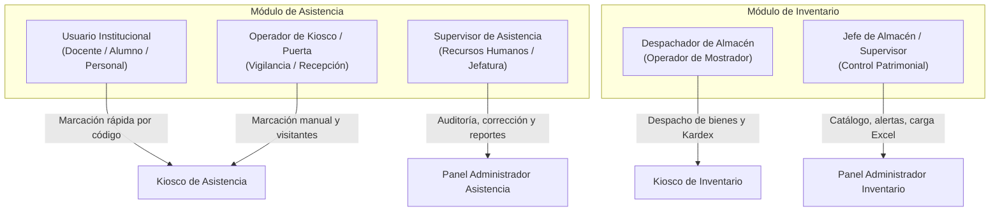
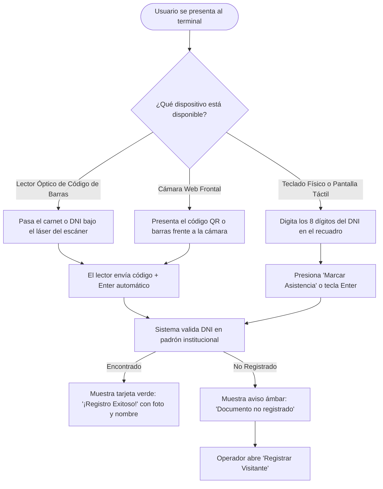
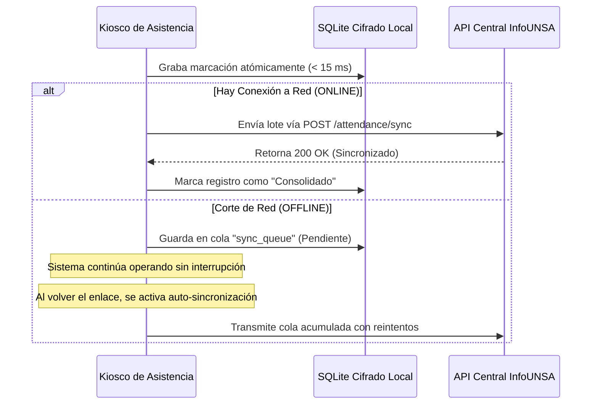
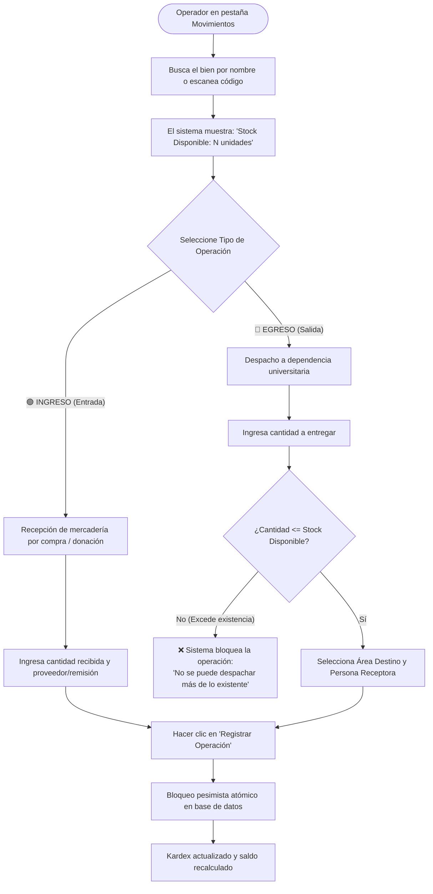
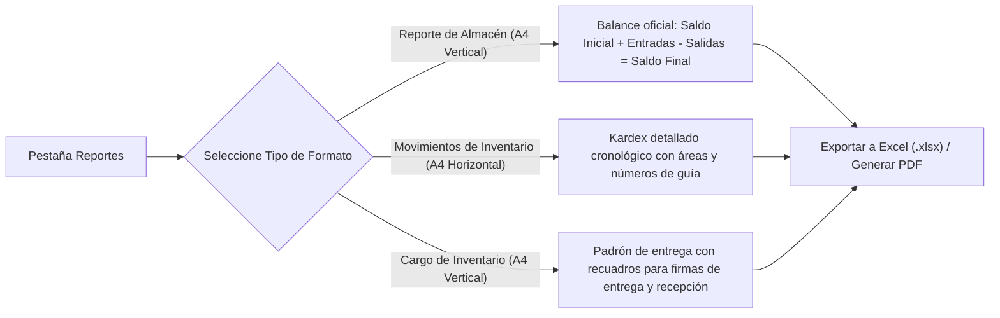

# Manual de Usuario Final Ilustrado — Asistencia e Inventario (Plataforma InfoUNSA)

**Documento:** Manual de Usuario Final y Guía Operativa de Terminales  
**Fecha:** 2026-10-29  
**Versión:** 2.0.0 (Entrega Final)  
**Autor:** Agente 1 (Primary Account — chamillo022@gmail.com)  
**Sistemas:** Plataforma InfoUNSA — Kiosco de Asistencia (`apps/asistencia/desktop`) y Kiosco de Inventario (`apps/inventario/desktop`)  
**Normas de Referencia:** ISO/IEC 25010 (Usabilidad y Calidad de Uso), ISO 9241-11 (Eficacia, Eficiencia y Satisfacción del Usuario), WCAG 2.1 AA (Accesibilidad).

---

## 1. Introducción y Propósito del Manual

El presente **Manual de Usuario Final Ilustrado** ha sido elaborado con un enfoque 100% práctico, amigable y estructurado para orientar al personal operativo, administrativo y de almacén de la **Universidad Nacional de San Agustín (UNSA)** en la interacción diaria con los sistemas de **Control de Asistencia** y **Gestión de Inventarios**.

### 1.1. Objetivos del Manual
1. **Guiar paso a paso** en la realización de las tareas habituales de marcación, despacho, consulta y emisión de reportes.
2. **Explicar la señalética visual, badges de estado y tooltips contextuales** incorporados en las interfaces optimizadas.
3. **Proporcionar tranquilidad operativa ante contingencias** explicando con claridad el funcionamiento del modo *Offline-First* (trabajo sin conexión a internet) y los mecanismos de resguardo automático de datos.
4. **Facilitar la rápida resolución de dudas** mediante una sección de Preguntas Frecuentes (FAQ) y un Glosario de términos universitarios y operativos.

### 1.2. Convenciones Gráficas y Alertas
A lo largo de este manual se emplean cuadros destacados con la siguiente convención:

> [!NOTE]
> Información complementaria, contexto operativo o recomendaciones para agilizar el trabajo.

> [!TIP]
> Atajos de teclado, consejos de ergonomía o trucos para ahorrar clics en ventanilla y mostrador.

> [!IMPORTANT]
> Requisitos indispensables o validaciones que el sistema exige para completar exitosamente la acción.

> [!WARNING]
> Acciones con impacto en la información, precauciones de seguridad o advertencias de stock bajo.

---

## 2. Mapa de Roles y Permisos de Usuario

Las interfaces de la Plataforma InfoUNSA están adaptadas a distintos perfiles de trabajo dentro de los campus y almacenes universitarios:



### Tabla de Responsabilidades por Rol

| Rol | Pantallas Principales | Funciones Clave |
| :--- | :--- | :--- |
| **Usuario Institucional** | Pantalla principal de Kiosco | Acercar su carnet universitario o DNI al lector de código de barras para registrar entrada o salida. |
| **Operador de Kiosco** | Kiosco, Modal de Visitantes | Supervisar el flujo de personas en puerta, registrar visitantes externos y registrar marcaciones manuales ante fotochecks deteriorados. |
| **Supervisor de Asistencia** | Dashboard, Log del Día, Reportes, Operadores, Configuración | Auditar las marcas diarias, revisar el historial forense de cambios, reactivar personal y generar la Matriz Semanal de asistencia en PDF/Excel. |
| **Despachador de Almacén** | Movimientos, Catálogo | Consultar existencias disponibles, recepcionar materiales y registrar la entrega física de bienes a las dependencias universitarias. |
| **Jefe de Almacén** | Dashboard, Catálogo, Alertas, Reportes, Carga Masiva | Crear y editar artículos, gestionar umbrales de stock mínimo, importar datos desde plantillas Excel y emitir Actas de Entrega de Cargo con firma. |

---

## 3. Módulo de Control de Asistencia

La aplicación de escritorio de Asistencia (`apps/asistencia/desktop`) combina un modo kiosco interactivo para registro masivo y fluido en puertas de acceso con un completo panel de administración para supervisores.

```
+-----------------------------------------------------------------------------------+
|  [Logo UNSA] CONTROL DE ASISTENCIA                                 [ ONLINE ] [?] |
+-----------------------------------------------------------------------------------+
|                                                                                   |
|                           REGISTRE SU ASISTENCIA                                  |
|                                                                                   |
|       +-------------------------------------------------------------------+       |
|       |  [|||||||||||||||||||||||] INGRESE O ESCANEE DNI / CARNET        |       |
|       +-------------------------------------------------------------------+       |
|                                                                                   |
|           [  (o) Lector Físico / Teclado  ]     [  ( ) Escáner Cámara Web  ]       |
|                                                                                   |
|                       [ 🟦 MARCAR ASISTENCIA (ENTER) ]                            |
|                                                                                   |
|       - - - - - - - - - - - - - - - - - - - - - - - - - - - - - - - - - - -       |
|       [ 👤 Registrar Visitante ]                  [ ⚙️ Panel Administrador ]     |
+-----------------------------------------------------------------------------------+
```

---

### 3.1. Acceso al Kiosco y Navegación
* Al encender el terminal o iniciar la aplicación, se despliega automáticamente la pantalla del **Kiosco de Marcación**.
* **Acceso al Panel de Supervisión:** Para acceder a las funciones avanzadas (bitácora, reportes, usuarios), el supervisor debe hacer clic en el botón inferior **`Panel Administrador`** o presionar la combinación de teclas rápida `Ctrl + Alt + A`, e ingresar sus credenciales autorizadas.

---

### 3.2. Proceso de Marcación de Asistencia

El sistema permite capturar la asistencia de tres formas adaptadas a la infraestructura del terminal:



#### Paso a Paso: Marcación con Lector Óptico de Código de Barras (Recomendado)
1. Verifique que el selector esté marcado en **`Lector Físico / Teclado`**.
2. Asegúrese de que el cursor se encuentre en la casilla de entrada (el recuadro parpadea en azul con autofocus permanente).
3. Aproxime el código de barras impreso al reverso del DNI físico o del carnet universitario al haz de luz del lector.
4. **Respuesta inmediata:** El lector emitirá un pitido sonoro (*beep*) y la pantalla desplegará la confirmación:
   * **Tarjeta Verde:** Muestra los nombres completos, apellidos, tipo de marcación detectada (*ENTRADA* o *SALIDA* de acuerdo a la alternancia de turnos) y hora exacta.
   * La tarjeta desaparecerá suavemente tras 3 segundos, dejando la pantalla lista para la siguiente persona.

#### Paso a Paso: Marcación Manual por Teclado o Pantalla Táctil
1. Si el código de barras está desgastado o el usuario carece del plástico en ese momento, toque o haga clic en la casilla de texto.
2. Escriba los **8 dígitos numéricos del DNI**.
3. Presione la tecla **`Enter`** de su teclado físico o toque el botón azul **`Marcar Asistencia`**.

> [!TIP]
> No es necesario hacer clic con el mouse tras un escaneo óptico: el lector envía automáticamente el carácter de confirmación de fin de línea (*Carriage Return*). El botón azul solo es requerido al tipear en pantallas táctiles o teclados numéricos.

---

### 3.3. Registro Excepcional de Visitantes y Transeúntes
Cuando una persona acude a una gestión universitaria sin pertenecer al padrón (proveedores, conferencistas, postulantes):
1. Haga clic en el botón **`👤 Registrar Visitante`**.
2. En la ventana modal emergente, complete los datos básicos:
   * **Tipo y Número de Documento:** DNI, Carnet de Extranjería o Pasaporte.
   * **Nombres y Apellidos Completos.**
   * **Institución o Empresa de Procedencia.**
   * **Motivo de la Visita o Dependencia de Destino** (ej. *Mesa de Partes*, *Decanato*, *Biblioteca*).
3. Haga clic en **`Guardar y Marcar Entrada`**.
4. **Modo Contingencia (Sin Documento):** Si la persona no porta identificación física y requiere pase de urgencia autorizado, presione el botón secundario **`Omitir y marcar como anónimo`**, que asignará un código correlativo temporal de auditoría.

---

### 3.4. Bitácora Diaria (`LogTab`) y Trazabilidad Forense
Desde el Panel Administrador, la pestaña **`Log del Día`** lista cronológicamente todos los registros del turno.

```
+-----------------------------------------------------------------------------------+
|  [Log del Día]   Buscar: [ DNI o Apellido... ]  Fecha: [ 2026-10-29 ]  [+ Manual] |
+-----------------------------------------------------------------------------------+
| HORA  | DNI      | NOMBRES Y APELLIDOS       | TIPO    | ORIGEN  | ESTADO  | ACC  |
|-------|----------|---------------------------|---------|---------|---------|------|
| 08:02 | 45892147 | FLORES MAMANI, CARLOS     | ENTRADA | KIOSCO  | NORMAL  | 👁️ ✏️ 🗑️|
| 08:15 | 70124589 | QUISPE CONDORI, ROSA      | ENTRADA | MANUAL  | NUEVO   | 👁️ ✏️ 🗑️|
| 12:45 | 41258963 | ZAPATA HUANCA, JORGE      | SALIDA  | KIOSCO  | EDITADO | 👁️ ✏️ 🗑️|
| 13:10 | 29584123 | BENITEZ VARGAS, ELENA     | ENTRADA | KIOSCO  | BORRADO | 👁️ -- --|
+-----------------------------------------------------------------------------------+
```

#### Significado de los Badges de Auditoría
* `NORMAL` (Verde): Marcación estándar capturada directamente por el lector de código de barras.
* `NUEVO` (Azul): Registro creado manualmente por el supervisor mediante el botón **`➕ Crear Registro Manual`**.
* `EDITADO` (Ámbar): Marcación cuya hora o justificación fue rectificada por el supervisor.
* `BORRADO` (Rojo / Texto Tachado): Marcación anulada. No se suprime físicamente de la base de datos para preservar la inalterabilidad jurídica y trazabilidad forense.

#### Acciones sobre cada Fila
* **Botón `👁️` (Historial / History):** Abre la línea de tiempo forense detallando quién creó la marca, a qué hora, qué IP se usó y qué modificaciones ocurrieron.
* **Botón `✏️` (Editar / Edit3):** Permite corregir la hora o ingresar un motivo de justificación oficial (ej. *Tardanza justificada por comisión de servicio*).
* **Botón `🗑️` (Anular / Trash2):** Solicita confirmación y anula la marca del balance diario.

---

### 3.5. Cola de Sincronización Offline y Resiliencia de Red
El sistema opera bajo el principio **Offline-First**. No depende de una conexión a internet ininterrumpida para funcionar:



* **Indicador en Cabecera:**
  * `SERVIDOR ONLINE` (Verde): Transmisión instantánea.
  * `SERVIDOR OFFLINE / MODO CONTINGENCIA` (Ámbar): Los datos se guardan con total seguridad bajo cifrado SQLCipher en el disco local del terminal.
* **Envío Manual:** En la pestaña **`Sincronización`** (`SyncTab`), el supervisor puede hacer clic en **`Subir Cola`** para forzar el vaciado de marcas hacia el servidor antes de apagar el equipo.

---

### 3.6. Emisión de Reportes (PDF y Excel)
En la pestaña **`Reportes`** (`ReportsTab`):
1. **Seleccione el Tipo de Reporte:**
   * **`Reporte Semanal (Matriz A4 Horizontal)`:** Consolida de lunes a domingo las horas de entrada y salida de todo el personal en una sola hoja por persona. Ideal para elevar a Recursos Humanos.
   * **`Reporte Detallado`:** Listado cronológico de todas las marcaciones con minutos exactos.
2. **Defina los Filtros:** Rango de fechas (desde / hasta) y casilla opcional **`Filtrar por días hábiles`** (excluye sábados y domingos).
3. **Exporte según su necesidad:**
   * **`Generar PDF`:** Abre el visor integrado para impresión directa en hojas membretadas oficiales.
   * **`Descargar Excel (.xlsx)`:** Descarga la hoja de cálculo editable con fórmulas automáticas de horas trabajadas.
   * **`Reporte Auditoría` (Botón Púrpura):** Exporta un archivo forense con todas las ediciones, anulaciones e identificadores de operador (requiere conexión al servidor central).

---

## 4. Módulo de Gestión de Inventarios y Almacén

La aplicación de escritorio de Inventario (`apps/inventario/desktop`) optimiza el control de existencias, la recepción de pedidos y el despacho seguro de materiales consumibles y bienes duraderos a las distintas escuelas y dependencias universitarias.

```
+-----------------------------------------------------------------------------------+
|  [Logo UNSA] GESTIÓN DE INVENTARIO Y ALMACÉN                       [ ONLINE ] [?] |
+-----------------------------------------------------------------------------------+
| [📊 Dashboard] [📦 Catálogo] [🔄 Movimientos] [⚠️ Alertas (3)] [📈 Reportes]      |
+-----------------------------------------------------------------------------------+
|                                                                                   |
|  BARRA DE CONTROL:                                                                |
|  Buscar: [ Papel Bond, Tóner o Código... ]  Categoría: [ Todos ▼ ]                |
|  Existencias: [ (o) Todos  ( ) Solo Crítico  ( ) Normal ]   [+ Catalogar Insumo]  |
|                                                                                   |
|  CATÁLOGO DE EXISTENCIAS:                                      Página 1 de 8      |
|  +--------+----------------------+---------------+--------+--------+------------+ |
|  | CÓDIGO | BIEN / INSUMO        | CATEGORÍA     | STOCK  | MÍNIMO | ACCIONES   | |
|  +--------+----------------------+---------------+--------+--------+------------+ |
|  | 000104 | Papel Fotocopia A4   | Papelería     | 145    | 30     | ✏️ 💬 🗑️   | |
|  | 000215 | Tóner HP LaserJet    | Informática   | 2      | 5 [!]  | ✏️ 💬 🗑️   | |
|  | 000340 | Alcohol Isopropílico | Limpieza      | 18     | 10     | ✏️ 💬 🗑️   | |
|  +--------+----------------------+---------------+--------+--------+------------+ |
|  [◀ Anterior]  Página: [1] [2] [3] ... [8]  [Siguiente ▶]   Mostrar: [ 15 ▼ ]     |
+-----------------------------------------------------------------------------------+
```

---

### 4.1. Panel Principal (`DashboardTab`)
Ofrece un resumen analítico instantáneo del almacén:
* **Tarjetas Métricas:** *Total de Artículos Catalogados*, *Bienes en Stock Crítico* (resaltado en rojo si requiere compra inmediata), *Movimientos del Mes* y *Estado del Servidor*.
* **Gráfico de Ingresos vs Egresos:** Visualiza el equilibrio mensual entre lo que entra por adquisiciones y lo que sale por entrega a las facultades.
* **Top 5 Áreas Solicitantes:** Muestra qué facultades o departamentos consumen mayor volumen de suministros.

---

### 4.2. Catálogo de Artículos y Control de Paginación
En la pestaña **`Catálogo`** (`CatalogTab`), el operador dispone de una vista despejada y ágil:

1. **Búsqueda Instantánea:** Comience a escribir en la casilla de búsqueda; los resultados se filtran en tiempo real por nombre del producto, código interno o código de barras EAN.
2. **Filtro de Existencias:**
   * **`Todos`:** Muestra la totalidad de bienes.
   * **`Solo Crítico`:** Aísla de inmediato aquellos artículos con saldo igual o inferior a su stock de seguridad.
   * **`Stock Normal`:** Artículos con abastecimiento suficiente.
3. **Navegación y Paginación:**
   * Utilice los botones **`◀ Anterior`** y **`Siguiente ▶`** o seleccione un número de página directo.
   * Ajuste la cantidad de registros visibles por pantalla (10, 15, 25, 50 o 100 artículos) mediante el selector desplegable **`Mostrar:`**.

#### Gestión de Fichas de Producto
* **Alta de Artículo (`+ Nuevo Ítem / Producto`):** Abre el formulario para registrar la denominación, código de barras, categoría, unidad de medida (Unidad, Millar, Caja, Paquete) y el stock mínimo de seguridad.
* **Edición de Ficha (`✏️`):** Permite actualizar nombres, descripciones y umbrales mínimos sin alterar el historial contable.
* **Observaciones y Series (`💬`):** Abre la bitácora para registrar números de serie de fábrica, garantías o notas de inspección física.
* **Baja de Artículo (`🗑️`):** Si un producto ya no se utilizará, permite retirarlo del catálogo.
  > [!IMPORTANT]
  > El sistema impide eliminar artículos que ya posean movimientos registrados en el Kardex institucional, salvaguardando la coherencia contable y auditoría de la Contraloría.

---

### 4.3. Registro de Movimientos de Entrada y Salida (`MovementsTab`)

El registro de movimientos es la operación central del despachador de almacén.



#### Paso a Paso para Registrar una Entrada (Ingreso):
1. Ingrese a **`Movimientos`**.
2. Escriba las primeras letras del insumo en el buscador y selecciónelo de la lista emergente.
3. Marque la opción **`🟢 INGRESO (Entrada)`**.
4. Especifique la cantidad física recibida.
5. Ingrese el número de Guía de Remisión, Orden de Compra o Factura en el campo de observaciones.
6. Verifique la fecha y hora de la transacción (puede ajustarse si la descarga física ocurrió en turno anterior).
7. Haga clic en **`Registrar Operación`**. El stock disponible aumentará de inmediato.

#### Paso a Paso para Registrar una Salida (Egreso):
1. Seleccione el insumo solicitado.
2. Observe el indicador visual **`Stock Disponible`**.
3. Marque la opción **`🔴 EGRESO (Salida)`**.
4. Digite la cantidad que entregará en ventanilla.
5. En el menú desplegable **`Área Destino`**, elija la facultad o dependencia solicitante (ej. *Facultad de Ingeniería de Producción y Servicios - Laboratorio 3*). Si el área es nueva, use la opción rápida **`+ Crear Nueva Área`**.
6. Escriba el nombre completo del docente o encargado que recepciona el bien en **`Persona Destinataria`**.
7. Haga clic en **`Registrar Operación`**.

> [!WARNING]
> **Prevención Estricta de Stock Negativo:** El sistema denegará cualquier intento de registrar un egreso superior al stock físico disponible. No existen "saldos negativos" en la plataforma, previniendo descalces en la auditoría patrimonial.

---

### 4.4. Monitor de Alertas de Stock Crítico (`AlertsTab`)
* Cuando un movimiento provoca que el saldo de un bien caiga por debajo de su umbral mínimo de seguridad, el sistema genera de forma automática una alerta activa.
* La pestaña **`⚠️ Alertas`** muestra un badge numérico con la cantidad de ítems desabastecidos.
* La tabla presenta el nombre del bien, el stock real remanente (resaltado en rojo) y el stock mínimo requerido, permitiendo al Jefe de Almacén preparar con anticipación el requerimiento de compras.
* Al efectuarse una nueva entrada que restituya el saldo sobre el mínimo, la alerta se resuelve automáticamente sin intervención manual.

---

### 4.5. Importación Masiva desde Plantillas Excel (`ExcelUploadTab`)
Para inventarios iniciales o adquisiciones por licitación pública con cientos de ítems:
1. Haga clic en el botón **`Descargar Plantilla Oficial Excel`**.
2. Complete las columnas normativas respetando los encabezados: *Código*, *Denominación*, *Categoría*, *Unidad de Medida*, *Stock Inicial* y *Stock Mínimo*.
3. Arrastre el archivo `.xlsx` sobre la zona de carga de la pantalla.
4. Revise la previsualización en pantalla. Puede usar los botones maestros de la cabecera:
   * **`Sobrescribir Todos`:** Actualiza la información de los artículos que ya figuren en el catálogo.
   * **`Ignorar Todos`:** Conserva intactos los datos de bienes existentes e importa solo los productos nuevos.
5. Haga clic en **`Importar a la Base de Datos`** para consolidar la carga masiva.

---

### 4.6. Generación de Reportes y Documentos Oficiales de Almacén
En la pestaña **`Reportes`** (`ReportsTab`):



1. **Formatos Disponibles:**
   * **`Reporte de Almacén (A4 Vertical)`:** Formato estándar de balance contable con columnas: *Saldo Inicial*, *Ingresos*, *Egresos* y *Stock Final*.
   * **`Movimientos de Inventario (A4 Horizontal)`:** Trazabilidad cronológica de todas las transacciones realizadas en un período.
   * **`Cargo de Inventario (A4 Vertical)`:** Documento formal con casillas de firma física para el *Entregador (Almacenero)* y el *Receptor (Responsable de Área)*, dotando de validez legal al traspaso de bienes.
2. **Exportación:** Presione **`Exportar Excel (.xlsx)`** para manipular datos numéricos, o **`Generar PDF`** para imprimir directamente.

---

## 5. Guía Maestra de Tooltips Contextuales y Señalética Visual

Para que los usuarios no tengan que memorizar funciones complejas, las interfaces incorporan **tooltips flotantes inteligentes** y microcopias explicativas en cada botón, control o indicador.

### 5.1. ¿Cómo interactuar con los Tooltips?

```
+-------------------------------------------------------+
|  [ 🟦 Marcar Asistencia ]                             |
|          |                                            |
|          v                                            |
|  +-------------------------------------------------+  |
|  |  Registra la asistencia para el DNI digitado.   |  |
|  |  (El lector óptico de barras dispara automático)|  |
|  +-------------------------------------------------+  |
+-------------------------------------------------------+
```

* **Con el Mouse (Cursor):** Pase el puntero y deténgase medio segundo sobre cualquier botón o ícono; aparecerá una burbuja oscura con bordes redondeados y texto claro explicando exactamente qué ocurrirá al hacer clic.
* **Con el Teclado (Accesibilidad):** Al desplazarse con la tecla `Tab`, cada botón seleccionado muestra su tooltip para usuarios con dificultades motrices o lectores de pantalla.
* **En Kioscos con Pantalla Táctil (Touch):** Mantenga presionado el botón durante medio segundo (*tap sostenido*) para leer la ayuda antes de confirmar la pulsación.

---

### 5.2. Catálogo Ilustrado de Tooltips: Control de Asistencia

| Control / Elemento | Pantalla / Ubicación | Mensaje del Tooltip | Significado Operativo |
| :--- | :--- | :--- | :--- |
| **Badge `SERVIDOR ONLINE`** | Cabecera general | *"Conexión activa con el servidor central. Las marcas se transmiten en tiempo real."* | Certeza de que la marca ya se encuentra registrada en la base de datos de la UNSA. |
| **Badge `MODO CONTINGENCIA`** | Cabecera general | *"Modo Contingencia: Las marcas se guardan cifradas localmente y se sincronizarán automáticamente al volver la red."* | La red cayó pero el terminal continúa trabajando normalmente sin perder un solo registro. |
| **Botón `Panel Administrador`** | Kiosco de asistencia | *"Acceso exclusivo para supervisores y operadores de asistencia (Atajo: Ctrl + Alt + A)"* | Evita pulsaciones indebidas de alumnos y recuerda el atajo rápido de teclado. |
| **Selector `Lector Físico / Teclado`** | Kiosco de asistencia | *"Modo para lectura rápida mediante código de barras o teclado numérico físico."* | Indica el método principal y más veloz de captura. |
| **Selector `Escáner Cámara Web`** | Kiosco de asistencia | *"Activa la cámara frontal del terminal para escanear el carnet institucional."* | Método alternativo si el lector láser manual presenta averías. |
| **Botón `➕ Crear Registro Manual`** | Log del Día | *"Permite ingresar una marcación justificada para personal cuyo carnet o DNI presentó fallas."* | Excepcionalidad: solo debe usarse previa autorización del supervisor. |
| **Badge `BORRADO`** | Log del Día | *"Marcación anulada administrativamente. Permanece en el sistema exclusivamente por auditoría."* | Explica por qué el registro aparece tachado pero visible para trazabilidad. |
| **Botón `Reporte Auditoría` (Púrpura)** | Reportes | *"Descarga un Excel forense con IP de origen, usuario creador y trazabilidad de cambios (Requiere ONLINE)."* | Documento confidencial para investigaciones de Recursos Humanos. |
| **Botón `Subir Cola`** | Pestaña Sincronización | *"Fuerza la transmisión inmediata de todos los registros pendientes hacia el servidor central."* | Permite asegurar que ningún registro quede local antes de apagar el kiosco al finalizar la jornada. |

---

### 5.3. Catálogo Ilustrado de Tooltips: Gestión de Inventarios

| Control / Elemento | Pantalla / Ubicación | Mensaje del Tooltip | Significado Operativo |
| :--- | :--- | :--- | :--- |
| **Tarjeta `Stock Crítico`** | Dashboard | *"Cantidad de bienes cuya existencia actual se encuentra por debajo del stock mínimo de seguridad."* | Resume cuántos insumos requieren reposición urgente. |
| **Botón `+ Catalogar Insumo`** | Catálogo / Movimientos | *"Permite crear y registrar un insumo nuevo que aún no existe en el catálogo central sin salir del formulario."* | Ahorra tiempo al recepcionar compras imprevistas sin cambiar de pestaña. |
| **Botón `Editar ítem` (`✏️`)** | Catálogo | *"Abrir ventana de modificación de denominación, categoría, unidad de medida y stock mínimo."* | Acceso a la ficha técnica del producto. |
| **Botón `Observaciones` (`💬`)** | Catálogo | *"Ver o agregar notas históricas, números de serie y observaciones del bien."* | Permite registrar marcas, series o números de lote. |
| **Casilla `Stock Disponible`** | Movimientos | *"Existencias físicas reales en almacén actualizadas en tiempo real."* | Muestra exactamente cuántas unidades quedan antes de autorizar una entrega. |
| **Selector `Tipo de Operación`** | Movimientos | *"Seleccione INGRESO para recepcionar compras/donaciones o EGRESO para despachar materiales a dependencias."* | Clarifica el sentido contable de la transacción física. |
| **Campo `Fecha/Hora de Registro`** | Movimientos | *"Fecha efectiva de la transacción física. Permite regularizar operaciones realizadas fuera de turno."* | Justifica por qué el campo es editable para arqueos de turno. |
| **Selector `Área Destino`** | Movimientos | *"Dependencia universitaria que recibe los materiales y asume la custodia del bien."* | Asigna la responsabilidad patrimonial del bien entregado. |
| **Botón `Sincronizar Operaciones`** | Movimientos / Historial | *"Envía las operaciones registradas offline y verifica la sincronización con el servidor central."* | Descarga novedades y asegura que el stock esté consolidado en la nube. |
| **Botón `Reporte de Almacén`** | Reportes | *"Genera el formato oficial de saldos y salidas con columnas: Cantidad inicial, Egresos y Stock final."* | Reporte reglamentario para fiscalización universitaria. |
| **Botón `Cargo de Inventario`** | Reportes | *"Genera el padrón completo de bienes con recuadros de firma para entrega y recepción conforme."* | Acta física que debe firmarse al entregar materiales. |

---

## 6. Preguntas Frecuentes del Personal Operativo (FAQ)

### Asistencia

**1. ¿Qué hago si la pantalla del Kiosco dice "MODO CONTINGENCIA" o "SERVIDOR OFFLINE"?**
> [!NOTE]  
> No se preocupe: el sistema continúa funcionando al 100%. Las personas pueden seguir pasando sus fotochecks o DNIs sin interrupción. Cada registro queda grabado y cifrado en el disco del equipo y se transmitirá automáticamente a la nube cuando regrese la red.

**2. El lector óptico pita pero no aparece el nombre en la pantalla. ¿Qué ocurrió?**
> Compruebe que la ventana del kiosco esté activa y que el cursor parpadee dentro de la casilla de texto. Si el foco se perdió por hacer clic en otra parte de la pantalla, simplemente haga clic en el recuadro blanco y vuelva a escanear.

**3. Una persona extravió su carnet y no recuerda su DNI. ¿Cómo marco su asistencia?**
> Solicite autorización a su supervisor para utilizar el botón **`👤 Registrar Visitante`** e ingrese sus nombres completos bajo la modalidad de contingencia.

**4. Me equivoqué al registrar una hora manual en la bitácora. ¿Puedo corregirla?**
> Sí. Como supervisor, ingrese al Panel Administrador, vaya a **`Log del Día`**, ubique la fila del colaborador y presione el botón **`✏️` (Editar)**. El sistema actualizará el dato y registrará el badge `EDITADO` para fines de auditoría.

---

### Inventario

**5. El sistema me dice "Stock insuficiente para realizar el egreso" y no me deja despachar. ¿Qué debo hacer?**
> El sistema no permite saldos negativos. Si en el estante físico usted tiene insumos que el sistema no reconoce, significa que la compra o entrega previa aún no fue ingresada al sistema. Debe registrar primero la operación de **`🟢 INGRESO`** y luego despachar la salida.

**6. ¿Cómo registro la entrega de un material a un departamento que no figura en la lista desplegable?**
> Dentro del formulario de **`Movimientos`**, al lado del campo de área destino, haga clic en el botón **`+ Crear Nueva Área`**. Digite el nombre de la nueva oficina o laboratorio y quedará guardada inmediatamente para futuros despachos.

**7. Al importar un archivo Excel me salió un error de formato. ¿Por qué ocurrió?**
> Asegúrese de haber descargado la **Plantilla Oficial** desde el botón de la cabecera. Si altera el nombre de las columnas o ingresa letras en la columna de stock numérico, el validador rechazará el archivo para proteger la integridad del catálogo.

**8. ¿Puedo anular un despacho de almacén si el docente devolvió los bienes en el mismo momento?**
> Si el material no salió físicamente del almacén o fue devuelto de inmediato, registre un movimiento de **`🟢 INGRESO`** por devolución especificando en las observaciones: *"Devolución por sobrante de material - Operación regularizada"*. De esta forma, el Kardex mantendrá un balance perfecto y verificable.

---

## 7. Glosario Operativo de Términos

* **Autofocus (Enfoque Automático):** Comportamiento mediante el cual la casilla de ingreso de DNI mantiene permanentemente activo el cursor, permitiendo pasar carnets uno tras otro sin tocar el mouse.
* **Badge de Estado:** Pequeña etiqueta de color (verde, ámbar, azul o rojo) que resume la condición jurídica o técnica de un registro (ej. `NORMAL`, `EDITADO`, `CRÍTICO`).
* **Bloqueo Pesimista (Pessimistic Locking):** Mecanismo de seguridad de la base de datos que "congela" temporalmente un producto durante milisegundos mientras se calcula el egreso, impidiendo que dos computadoras vendan o despachen el mismo bien a la vez.
* **Cargo de Inventario:** Documento formal con validez institucional donde constan los bienes entregados y los casilleros de firma para la persona que despacha y la que recibe en custodia los materiales.
* **Código EAN / Barras:** Secuencia numérica representada en líneas verticales impresas en carnets o empaques de productos, leída de forma instantánea mediante dispositivos ópticos láser.
* **Kardex:** Historial cronológico inalterable de todos los ingresos, egresos y saldos de un producto a lo largo del tiempo.
* **Modo Contingencia (Offline):** Estado de funcionamiento en el cual el terminal no cuenta con red hacia el servidor central pero continúa registrando operaciones de manera autónoma en su base de datos local protegida.
* **Outbox (Bandeja de Salida):** Cola protegida donde se acumulan las transacciones registradas localmente en espera de ser confirmadas por el servidor central de la universidad.
* **SQLCipher:** Motor de base de datos local que almacena la información cifrada mediante algoritmos de grado bancario (AES-256), impidiendo que personal no autorizado extraiga datos si el equipo sufre un robo físico.
* **Stock Mínimo (Umbral de Seguridad):** Cantidad mínima admisible de un bien en almacén antes de que el sistema emita una advertencia preventiva de compra o reposición.
* **Tooltip Contextual:** Mensaje flotante de texto conciso que aparece sobre un botón o indicador para explicar qué hace y orientar al usuario en su uso correcto.
* **Trazabilidad Forense:** Capacidad del sistema para demostrar en cualquier momento quién creó un registro, qué modificaciones se le hicieron, desde qué equipo y a qué hora exacta.

---

> [!NOTE]
> **Soporte Técnico y Consultas:** Para incidencias técnicas no resueltas en este manual, comuníquese con el Área de Tecnologías de Información de la UNSA o eleve una solicitud a través del Portal de Servicios Institucionales.
